# Parcha

**The prescription, made for the person who has to take it.** Parcha turns a
doctor's prescription into reminders an elderly patient can actually follow —
the photo of the strip in her hand, the time said out loud in her language,
one tap for "taken" — and lets the rest of the family see that she did.

> A government hospital in Kolkata audited 380 of its own prescriptions: **96%
> legible, 86% complete — and 36.8% of those patients did not understand what
> they had been given.** A correct prescription stops working the moment the
> patient leaves the room. That gap is what Parcha is built for.

<p align="center">
  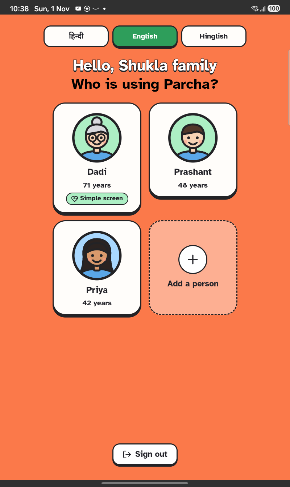
  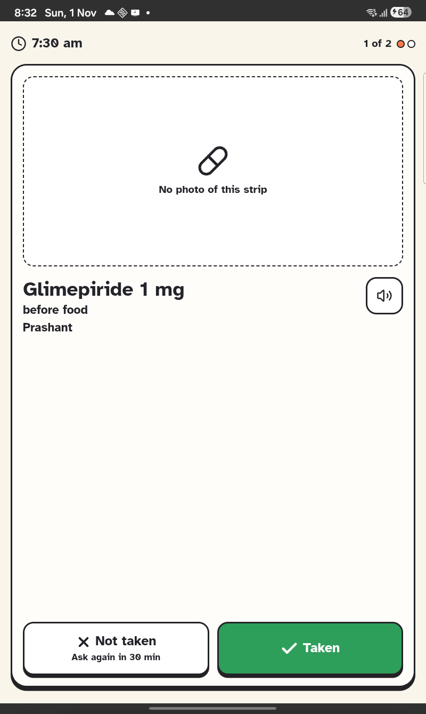
  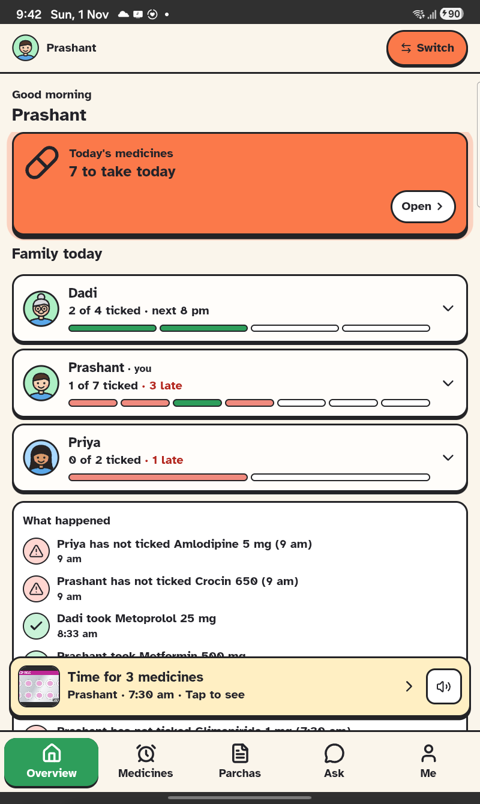
  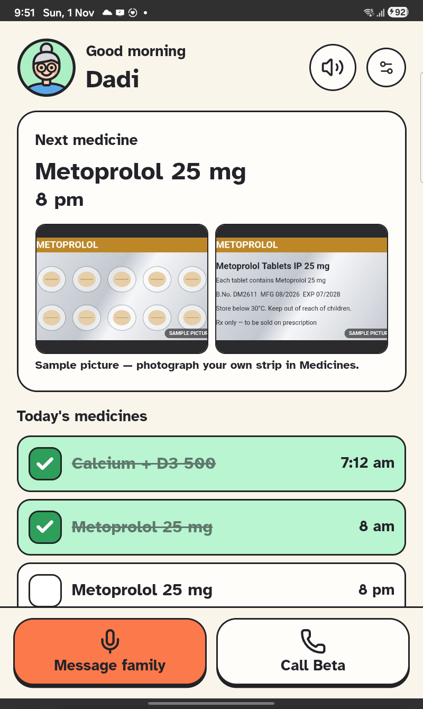
  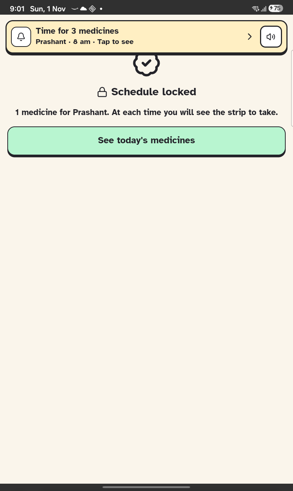
</p>
<p align="center"><sub>Every screenshot above is from the Android app running on a real Galaxy Tab A9 (Android 16), against the live backend.</sub></p>

---

## For judges: the two-minute path

| | |
| --- | --- |
| **Android app** | **https://parcha-android.web.app** — scan the QR, install the APK |
| **Same app in a browser** | https://parcha.web.app |
| **Clinic app** (where a Parcha is written) | https://parcha-clinic.web.app |
| **Demo family phone** | **9811044321** — the Shukla family: Dadi (Prabha Devi, 71), Prashant (48), Priya (42) |

1. **Pick a person.** The phone greets the family and asks who is using it. Pick **Prashant**.
2. **Overview.** Each family member's doses today, which are late, and a feed of what happened ("Dadi took Metoprolol at 8:33").
3. **Tap the yellow banner** (when a dose is due). One card per medicine, the strip's photo on top, **Taken** or **Not taken** (asks again in 30 minutes).
4. **New Parcha → No → add a medicine.** Nothing is guessed: times start empty, every medicine is confirmed by hand, then each strip is photographed front and back, then the schedule is **locked**.
5. **Switch → Dadi.** Her simple screen says aloud when her next medicine is, shows the strip to look for, and has one button to **record a voice message** for the family.
6. **Parchas → Simple Parcha.** The prescription redrawn for an old person: pictures for morning/afternoon/night, food in her words, the last day as a date, and a button that reads it out.

---

## The patient journey

```
  "Do you have a printed Parcha?"
        │
   ┌────┴─────────────────────────────┐
  YES                                 NO
   │                                   │
 scan the signed QR               photograph the pharmacy bill
 (checked on the phone,           → names read ON the phone, each boxed on the photo
  no network)                     → the doctor/chemist's words (keyboard mic)
   │                              → each medicine pre-filled only from what was said
 or photograph the slip           → green / yellow / red: bill vs. words
 → read on the phone,                  │
   times taken from the printed line   │
   └────────────────┬──────────────────┘
                    ▼
     every medicine confirmed by a person ("Yes, this is right")
                    ▼
     each strip photographed, front and back, one medicine at a time
                    ▼
     schedule created and LOCKED  ──→  a Simple Parcha to keep
                    ▼
  at dose time: a banner with the strip → one card per medicine → Taken / Not taken
  on Android:   a full-screen "call" in Hindi → हाँ, ले ली · नहीं ली · संदेश रिकॉर्ड करें
  not taken:    asked again in 30 minutes — the app, the alarm and the phone call agree
                    ▼
  the family's Overview: who took what, what is late, Dadi's voice messages
```

## On a real device

| New Parcha | Nothing is invented | Confirm each one | Each strip, one at a time |
| --- | --- | --- | --- |
| 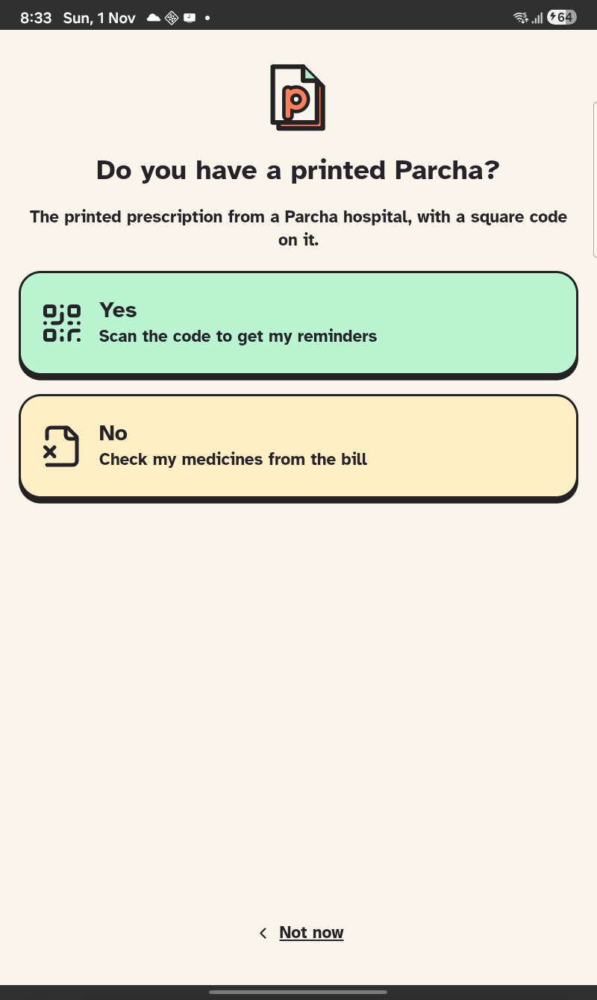 | 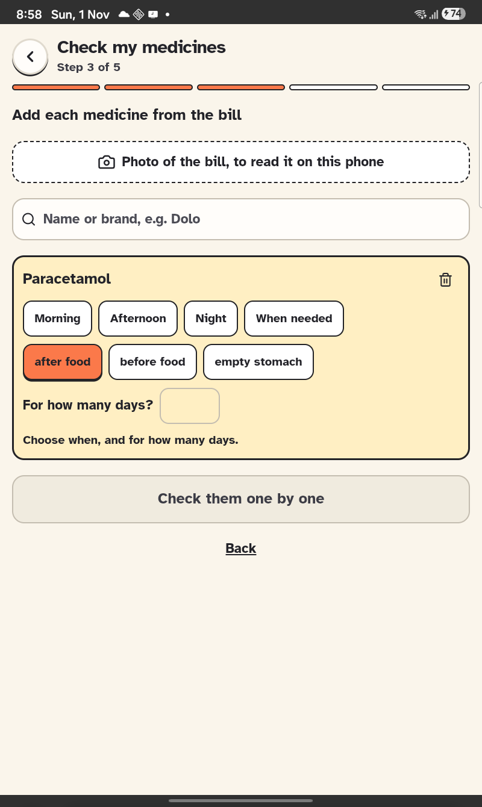 | 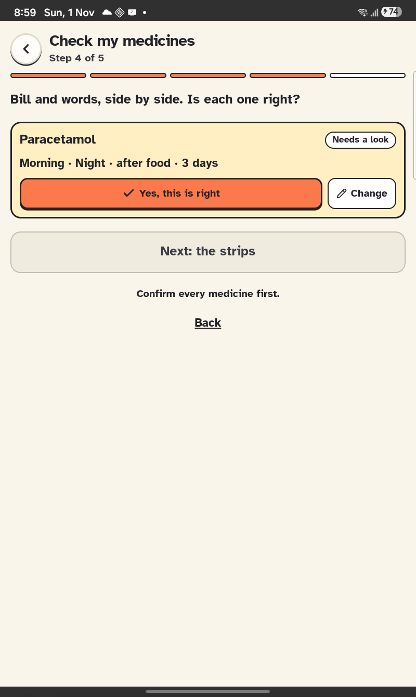 | 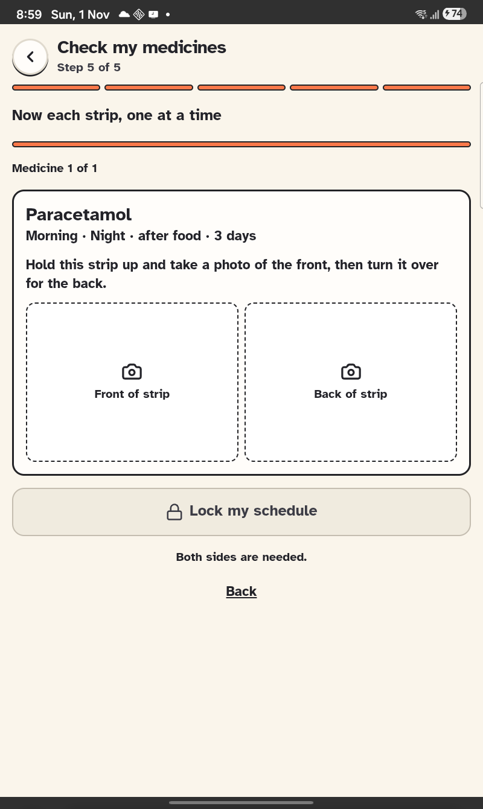 |
| Printed (QR or photo) or not (bill + voice). | A medicine with no time said or printed starts empty and blocks the next step. | Every medicine, green ones too, is ticked by a person. | Both sides needed; the phone checks the name is on the strip. |

| Strip checked on the phone | Dose card | Family, expanded | Ticked, and to come |
| --- | --- | --- | --- |
| 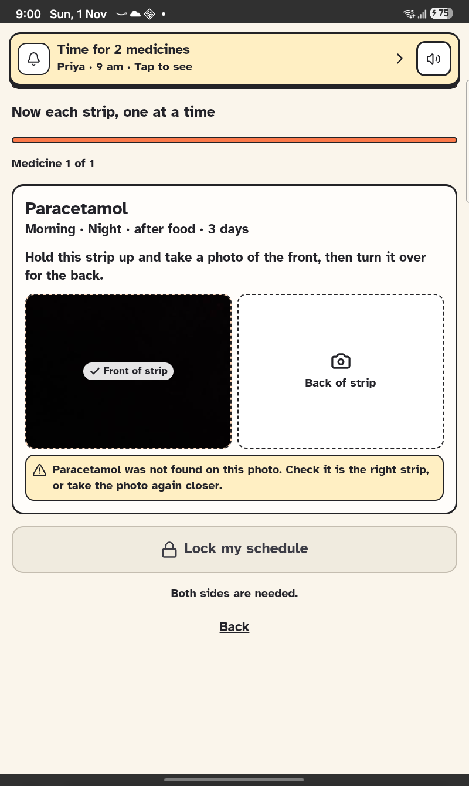 |  | 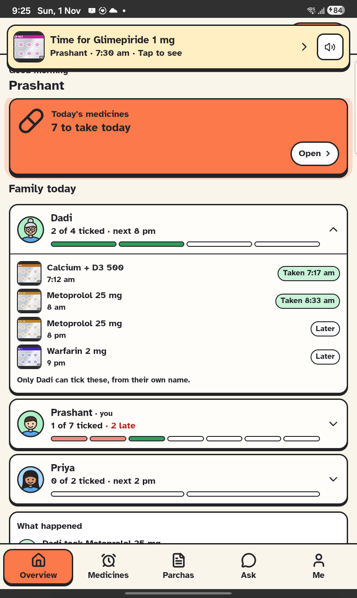 | 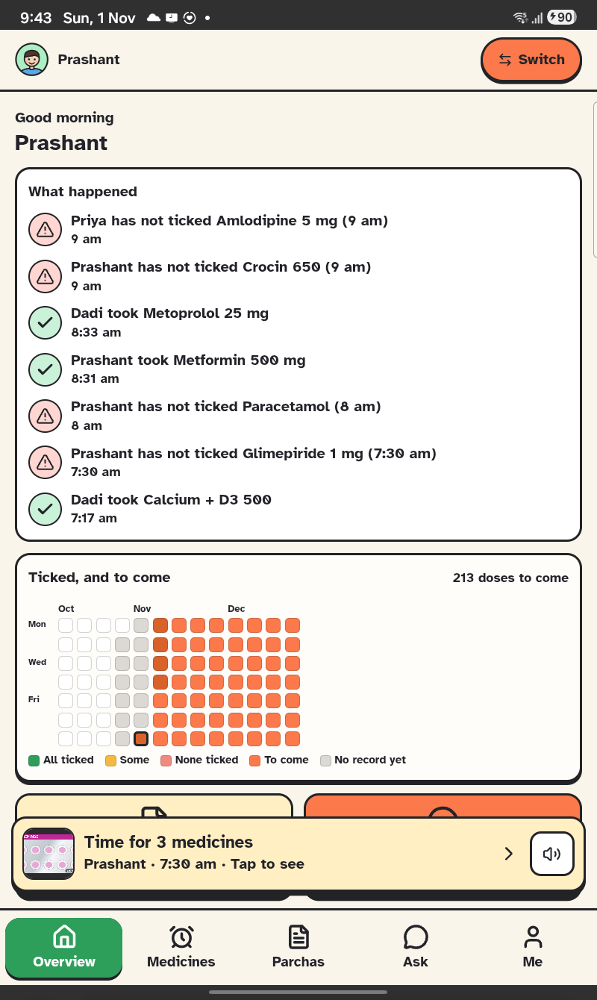 |
| A wrong strip is caught before it becomes the picture at dose time. | One medicine per card. Three at 8 am are three cards. | Read-only: only Dadi can tick Dadi's doses. | Behind today: what was ticked. Ahead: what is scheduled. Grey: no record yet. |

| Dadi's screen | A voice message | Schedule locked | Hello, family |
| --- | --- | --- | --- |
|  | 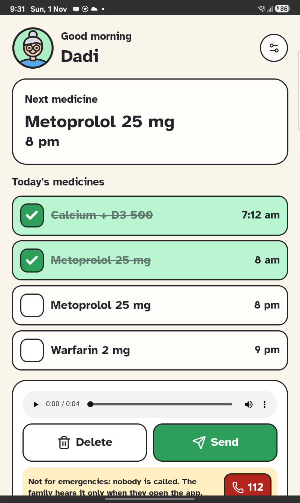 |  |  |
| Speaks the next time on opening (female Hindi voice), with mute. | Up to 30 s, heard back before it is sent. | Locked reminders cannot be edited or deleted; a newer Parcha replaces them. | Whatever is chosen is green, everywhere. |

## Honest by design

These are rules in the code, not wishes in a slide:

- **No time is ever invented.** A medicine nobody said or printed a time for starts empty and cannot go forward. Defaults that look helpful are how wrong doses happen.
- **A human confirms every medicine.** Green "matches" included. Changing a medicine un-confirms it.
- **AI only fills in, on the phone.** Bill and strip reading run on the device (Tesseract, models served locally). Every name is boxed on the photo with *why* it counts; nothing is added until a person taps Add; nothing is uploaded.
- **Signed vs. checked is never blurred.** A Simple Parcha says "Signed by the doctor" only when it came from a verified QR; otherwise "Checked by the family against the bill. No doctor signed this copy."
- **Doses belong to the person who takes them.** On a shared phone, Prashant cannot tick Dadi's dose; a slip naming someone else is refused, with a button to switch.
- **"Not ticked", never "missed".** A dose taken and not ticked looks the same from outside, and the words say so.
- **Sample pictures say they are samples** — on the picture and beside it — and never count as photographed.
- **A voice message is not an emergency service**, and the screen says so: nobody is called, the family hears it when they open the app. Nothing transcribes or interprets it.
- **The phone and the clinic stay apart.** A handset reads **nothing** under the clinic's records ([firestore.rules](firestore.rules)). The prescription crosses on paper, through the signed QR.
- **A locked schedule is locked on the server too**, not just hidden in the UI ([reminders.ts](firebase/functions/src/reminders.ts)).

## What is in the box

| | Who | What |
| --- | --- | --- |
| **Patient app** [`apps/patient`](apps/patient) | Families | **Overview** (each person's doses, the family feed, voice messages, the history wall), **Medicines**, **Parchas** (with Simple Parcha), **Ask** (answers only from the Parchas on the phone), **Me** (family, PIN, sealed backup, *Show the doctor*: a QR or a 15-minute link). Hindi, English or Hinglish per person. Android app and PWA. |
| **Android extras** | Elders | Local alarms that work offline; a native full-screen reminder "call" with the strip, three answers and a voice recorder; reminders spoken in a woman's Hindi voice. |
| **Clinic app** [`apps/clinic`](apps/clinic) | Desk and doctors | Register → vitals → consult → **deterministic safety check** (allergy, interactions, vitals, age, max dose by weight, pregnancy) → sign → print a Parcha with a signed QR. Pharmacy, billing (cash, UPI, card, Razorpay), management, end-to-end encrypted staff messages. |
| **Desktop** [`apps/desktop`](apps/desktop) | Front desk | The clinic app as a Windows program with its own encrypted copy. |

<details>
<summary><b>The clinic side, in pictures</b></summary>

| Front desk | Doctor |
| --- | --- |
| 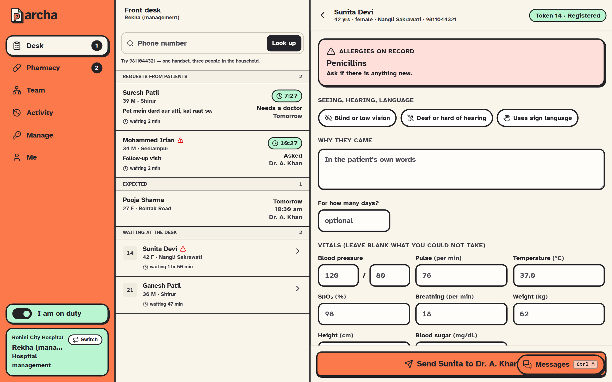 | 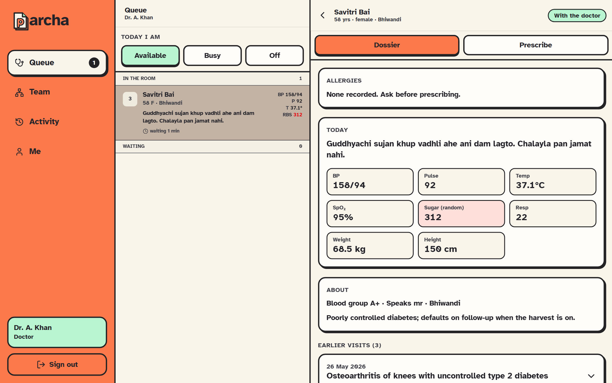 |

**The safety check** runs while the doctor prescribes, and again on the server when they sign.

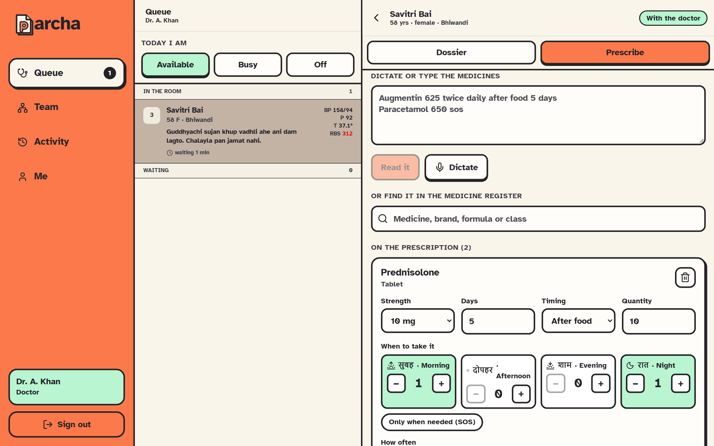

| Signed and ready to print | Who is on duty |
| --- | --- |
| 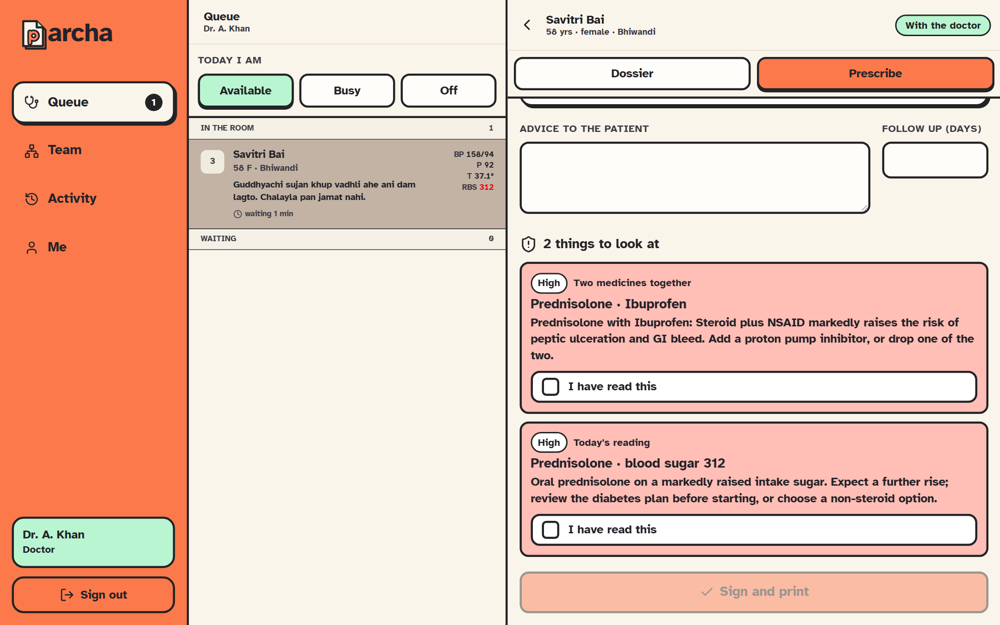 | 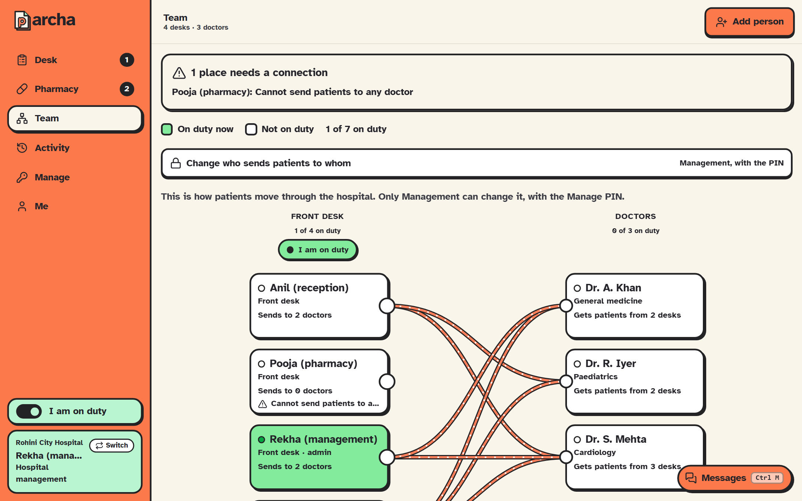 |

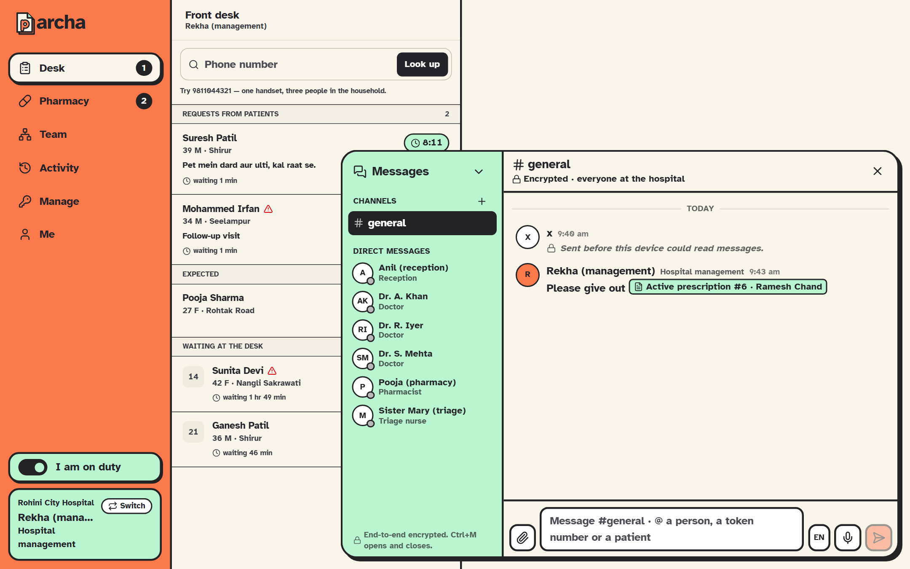
</details>

## What is real, and what is not

**Proven on a real Android tablet** (Galaxy Tab A9, Android 16, live backend): the
dose cards with Taken / Not taken; the bill-path New Parcha from search to a
locked schedule, including two real camera round trips and the on-device strip
check; the Overview and family feed; Dadi's screen speaking on open; recording a
voice message in the app; the "Hello, Shukla family" switcher; green selection.

**Tested in code:** 181 unit tests (`npm test`), including the dose-line reader
for printed Parchas and the plain call script; 69 integration tests for rules and
functions against the emulators (last run before this round of changes).

**Written but not yet proven:**

- **Voice messages reaching the family** need the `sendFamilyMessage` / `heardFamilyMessage` functions and the new rule deployed to the live project. Until then, sending says it failed and keeps the recording.
- **The native call screen's three answers and recorder** are built into the APK but were not rung end to end on the tablet in this round.
- **Real telephone calls** (Twilio) are wired and unrun against a live account ([docs/CALLING.md](docs/CALLING.md)).
- **A locked phone**: Android 14+ withholds full-screen intents from apps it does not read as alarms; over a locked screen the reminder is unproven.
- **Agent memory (Meko)**: the API key works; the export stays parked until Secret Manager is enabled on the project.
- Indian OEM battery savers (Xiaomi, Oppo, Vivo) can delay alarms — untested.
- The APK is a debug build. There are no real users yet.

## Run it

Node 22+ and Java 11+ (for the emulators). No cloud account needed.

```bash
npm install
npm run emulators        # auth, firestore, functions
npm run seed             # demo hospitals, doctors and the Shukla family
npm run dev:patient      # http://localhost:3001
npm run dev:clinic       # http://localhost:3000
```

```bash
npm test                  # unit tests
npm run test:integration  # rules + functions, with the emulators running
npm run check             # typecheck both apps and build the functions
node apps/patient/scripts/android.mjs live   # the Android APK, against the live backend
```

## How it is built

```
apps/patient       patient PWA + Android app (Vite, React, Capacitor; native Java for the call screen)
apps/clinic        staff web app (Vite, React)
apps/desktop       Electron wrapper
packages/core      pure logic: schedule, safety check, bill/strip reading, call scripts — all unit-tested
packages/client    Firebase wiring, hooks, the encrypted vault and offline outbox
packages/ui        shared components and theme
firebase/functions every write, checked on the server (Cloud Functions, asia-south1)
```

**Clients never write clinical data.** Rules deny it; every change is a callable
function, so "only a doctor can sign" and "a locked schedule stays locked" are
enforced where they cannot be skipped. Details: [docs/SECURITY.md](docs/SECURITY.md),
[docs/DATA-MODEL.md](docs/DATA-MODEL.md).

## Documentation

Everything is indexed in [docs/README.md](docs/README.md): getting started, the
demo guide, architecture, data model, security, functions API, the safety
check, offline, both apps screen by screen, reminder calls, Android, deploying,
standards (ABDM, ABHA, FHIR), testing, and the research behind it.

## Contributing

Pull requests pass CI (types, unit tests, builds, integration tests against the
emulators). Logic both the apps and the functions need lives in `packages/core`,
with a test. A new write is a new function, never a client write.

## Licence

No licence file has been added yet.
