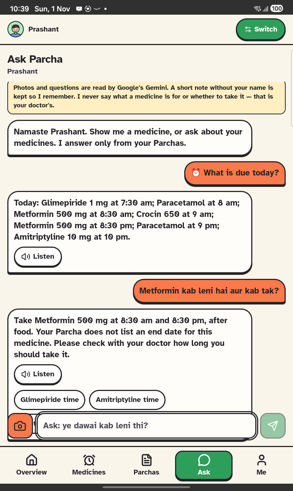
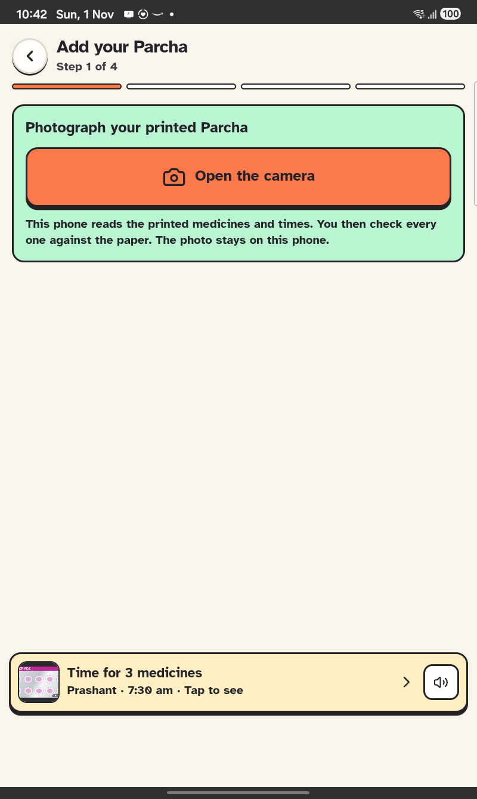
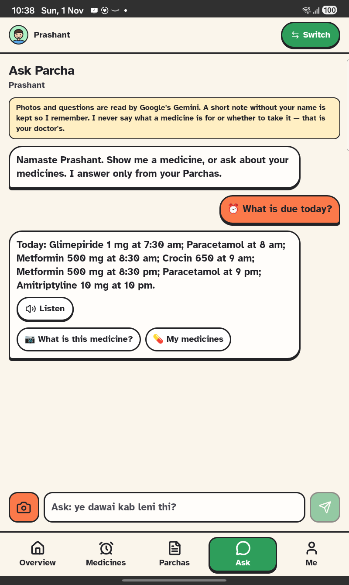
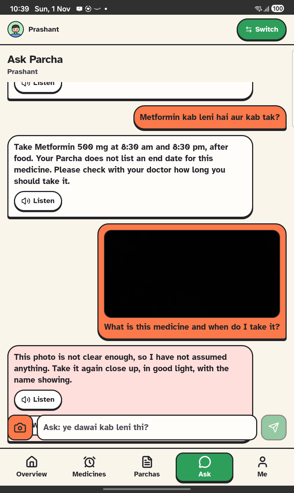

# Parcha

**Dadi's medicines, made simple enough to follow — and visible to the family that worries about her.**

<p align="center">
  
  
  
  
  
</p>
<p align="center"><sub>Every screenshot here is the Android app on a real Galaxy Tab A9, against the live backend.</sub></p>

## The story

Prabha Devi is 71. Her doctor writes three medicines on a slip. By the time she is home, the slip is a list of names she cannot read, and her son Prashant, at work, has no idea whether she took the 8 o'clock one.

A study of 380 prescriptions at a Kolkata hospital found them **96% legible — and 36.8% of patients still did not understand them.** The prescription was fine. Nothing after it was.

Parcha is everything after it.

**Try it:** install from **https://parcha-android.web.app** (or open https://parcha.web.app) and use the demo family phone **9811044321** — the Shukla family: Dadi, Prashant and Priya.

---

## 1 · The Parcha comes home

<table><tr>
<td width="25%"></td>
<td width="25%"></td>
<td width="25%"></td>
<td width="25%"></td>
</tr><tr>
<td><b>Printed or not?</b> No slip at all? Photograph the pharmacy bill and say what the doctor said.</td>
<td><b>Printed:</b> photograph it. The phone reads the names and the times printed beside them — on the device.</td>
<td><b>A person confirms every medicine.</b> Nothing is guessed: a medicine with no time printed or said starts empty.</td>
<td><b>Each strip, front and back,</b> one medicine at a time. Then the schedule is <b>locked</b>.</td>
</tr></table>

## 2 · The dose arrives

<table><tr>
<td width="25%"></td>
<td width="25%"></td>
<td width="25%"></td>
<td width="25%"></td>
</tr><tr>
<td><b>One card per medicine,</b> the strip's photo on top. <b>Taken</b>, or <b>Not taken</b> — asked again in 30 minutes.</td>
<td><b>Dadi's screen</b> says when her next medicine is, in Hindi, in a woman's voice. Mute, big targets, Message family and Call always at the bottom.</td>
<td><b>Her voice for the family:</b> "the white tablets are finished". Up to 30 s, heard back before it is sent.</td>
<td>On Android the reminder can ring like a call, in her language: <b>हाँ, ले ली · नहीं ली · संदेश रिकॉर्ड करें</b>.</td>
</tr></table>

## 3 · The family sees

<table><tr>
<td width="33%"></td>
<td width="33%"></td>
<td width="33%"></td>
</tr><tr>
<td><b>Overview:</b> each person's doses today, what is late, and a feed — "Dadi took Metoprolol at 8:33", "Dadi sent a message".</td>
<td><b>Look, don't touch:</b> only Dadi can tick Dadi's doses. Her strips and times, read-only.</td>
<td><b>Ticked, and to come:</b> green, amber, red behind today; the schedule ahead; grey where there is no record.</td>
</tr></table>

## 4 · Ask — the helper that knows her Parchas

<table><tr>
<td width="33%"></td>
<td width="33%"></td>
<td width="33%"></td>
</tr><tr>
<td><b>A guided chat.</b> What is this medicine? Has it expired? What is due today? Or just type <i>"ye dawai kab leni thi?"</i></td>
<td><b>Answers from her own records,</b> with the times and the doctor, in Hindi, English or Hinglish — and a Listen button.</td>
<td><b>An unclear photo is refused</b> on the phone, before anything is sent. Never assumed.</td>
</tr></table>

How it thinks: **Gemini reads** the photo into a fixed shape (name, strength, expiry, how sure). **Code decides** whether that medicine is on her Parcha and whether it has expired — plain, tested functions, not a model's opinion. **Meko remembers** what she asked before, keyed by a salted hash, never a name. Then Gemini words the reply under rules it cannot talk round: nothing about what a medicine is for, no advice to start, stop or change a dose. *"Not on your Parcha — do not take it until a doctor confirms"* and *"expired — do not take it"* are said by code, every time.

---

## Honest by design

| Rule | Where it lives |
| --- | --- |
| No time is ever invented | [CheckMedicines.tsx](apps/patient/src/screens/CheckMedicines.tsx) |
| An unclear photo is refused, never read hopefully | [photoQuality.ts](packages/core/src/photoQuality.ts) |
| Ask never says what a medicine is for; "not on your Parcha" and "expired" are said by code | [assistant.ts](firebase/functions/src/assistant.ts) |
| A locked schedule stays locked — on the server | [reminders.ts](firebase/functions/src/reminders.ts) |
| A dose is ticked only by the person who takes it | [DoseCards.tsx](apps/patient/src/screens/DoseCards.tsx) |
| Sample pictures and sample Parchas say they are samples | [demoStrips.ts](apps/patient/src/components/demoStrips.ts) |
| A voice message is not an emergency service, and says so | [messages.ts](firebase/functions/src/messages.ts) |

## What is proven, and what is not

**On the tablet:** dose cards; New Parcha from the bill to a locked schedule, with real camera round trips; Overview and the family feed; Dadi's spoken screen; recording a voice message; Ask answering a typed question and refusing an unclear photo. **Against the live backend:** Ask read a photographed strip, matched it to the right Parcha, read its expiry and answered in Hindi; refused a dark photo; said plainly when a strip was not on that person's Parcha; refused to say what a medicine is for; recalled an earlier question from Meko. **In code:** 191 unit tests.

**Not yet:** the native call screen's three answers were not rung end to end; reminders over a *locked* phone are unproven on Android 14+; Indian OEM battery savers are untested. The APK is a debug build, and there are no real users yet.

## Under the hood

```
apps/patient        the family's app — React + Capacitor (Android), native Java for the call screen
packages/core       pure, tested logic: schedules, reading, photo rules, expiry, matching
packages/client     Firebase wiring, the encrypted on-phone vault, the offline outbox
firebase/functions  every write checked on the server; Ask (Gemini + Meko) lives here
```

```bash
npm install && npm run emulators && npm run seed && npm run dev:patient   # http://localhost:3001
npm test                                                                  # unit tests
node apps/patient/scripts/android.mjs live                                # the Android APK
```
