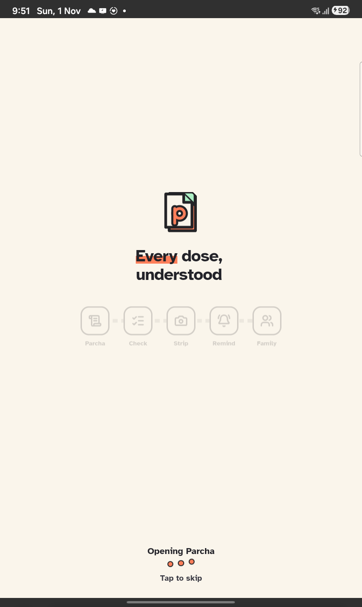

# Parcha

**Dadi's medicines, made simple enough to follow — and visible to the family that worries about her.**

<p align="center">
  
  
  
  
  
</p>
<p align="center"><sub>Every screenshot here is the Android app on a real Galaxy Tab A9, against the live backend.</sub></p>

## The story

Prabha Devi is 71. Her doctor writes three medicines on a slip. By the time she is home, the slip is a list of names she cannot read, and her son Prashant, at work, has no idea whether she took the 8 o'clock one.

A study of 380 prescriptions at a Kolkata hospital found them **96% legible — and 36.8% of patients still did not understand them.** The prescription was fine. Nothing after it was.

Parcha is everything after it.

**Try it:** install from **https://parcha-android.web.app** (or open https://parcha.web.app) and use the demo family phone **9811044321** — the Shukla family: Dadi, Prashant and Priya.

---

## 1 · The Parcha comes home

<table><tr>
<td width="25%"></td>
<td width="25%"></td>
<td width="25%"></td>
<td width="25%"></td>
</tr><tr>
<td><b>Printed or not?</b> Scan the signed QR, photograph the slip, or — with no slip — photograph the pharmacy bill and say what the doctor said.</td>
<td><b>Nothing is guessed.</b> A medicine with no time said or printed starts empty and blocks the next step.</td>
<td><b>A person confirms every one.</b> Bill and spoken words are compared; green ones still need a tap.</td>
<td><b>Each strip, front and back,</b> one medicine at a time. Then the schedule is <b>locked</b>.</td>
</tr></table>

## 2 · The dose arrives

<table><tr>
<td width="25%"></td>
<td width="25%"></td>
<td width="25%"></td>
<td width="25%"></td>
</tr><tr>
<td><b>One card per medicine,</b> the strip's photo on top. <b>Taken</b>, or <b>Not taken</b> — asked again in 30 minutes.</td>
<td><b>Dadi's screen</b> says when her next medicine is, in Hindi, in a woman's voice. A mute button. Big targets.</td>
<td><b>Her voice for the family:</b> "the white tablets are finished". Up to 30 s, heard back before it is sent.</td>
<td>On Android the reminder can ring like a call: <b>हाँ, ले ली · नहीं ली · संदेश रिकॉर्ड करें</b>.</td>
</tr></table>

## 3 · The family sees

<table><tr>
<td width="33%"></td>
<td width="33%"></td>
<td width="33%"></td>
</tr><tr>
<td><b>Overview:</b> each person's doses today, what is late, and a feed — "Dadi took Metoprolol at 8:33".</td>
<td><b>Look, don't touch:</b> only Dadi can tick Dadi's doses. Her strips and times, read-only.</td>
<td><b>Ticked, and to come:</b> green, amber, red behind today; the schedule ahead; grey where there is no record.</td>
</tr></table>

## 4 · Ask *(being built now)*

A chat that knows the family's own Parchas. Photograph a strip and ask *"ye dawai kab leni thi?"* — it reads the strip, finds it on her Parcha, checks the expiry, and answers from the record, never from imagination. Gemini reads the photo; Meko remembers the conversation; matching and expiry are plain, tested code.

---

## Honest by design

| Rule | Where it lives |
| --- | --- |
| No time is ever invented | [CheckMedicines.tsx](apps/patient/src/screens/CheckMedicines.tsx) |
| An unclear photo is refused, never read hopefully | [photoQuality.ts](packages/core/src/photoQuality.ts) |
| A locked schedule stays locked — on the server | [reminders.ts](firebase/functions/src/reminders.ts) |
| A dose is ticked only by the person who takes it | [DoseCards.tsx](apps/patient/src/screens/DoseCards.tsx) |
| "Signed by the doctor" only for a verified QR; samples say they are samples | [SimpleParcha.tsx](apps/patient/src/screens/SimpleParcha.tsx) |
| A voice message is not an emergency service, and says so | [messages.ts](firebase/functions/src/messages.ts) |
| The phone reads nothing of the clinic's records | [firestore.rules](firestore.rules) |

## What is proven, and what is not

**On the tablet:** dose cards, the bill path from search to a locked schedule (with real camera round trips), Overview and the feed, Dadi's spoken screen, recording a voice message, green selection, photo refusal. **In code:** 191 unit tests.

**Not yet:** voice messages reaching the family needs the latest functions deployed; the native call screen's three answers weren't rung end to end; real telephone calls (Twilio) are unrun; reminders over a *locked* phone are unproven on Android 14+. The APK is a debug build, and there are no real users yet.

## Under the hood

```
apps/patient        the family's app — React + Capacitor, native Java for the call screen
apps/clinic         where the Parcha is written: safety check, sign, print a signed QR
packages/core       pure, tested logic: schedules, reading, photo rules, expiry
firebase/functions  every write checked on the server
```

```bash
npm install && npm run emulators && npm run seed && npm run dev:patient   # http://localhost:3001
npm test                                                                  # unit tests
```

More in [docs/](docs/README.md) — architecture, security, the clinic app, Android, deploying.
