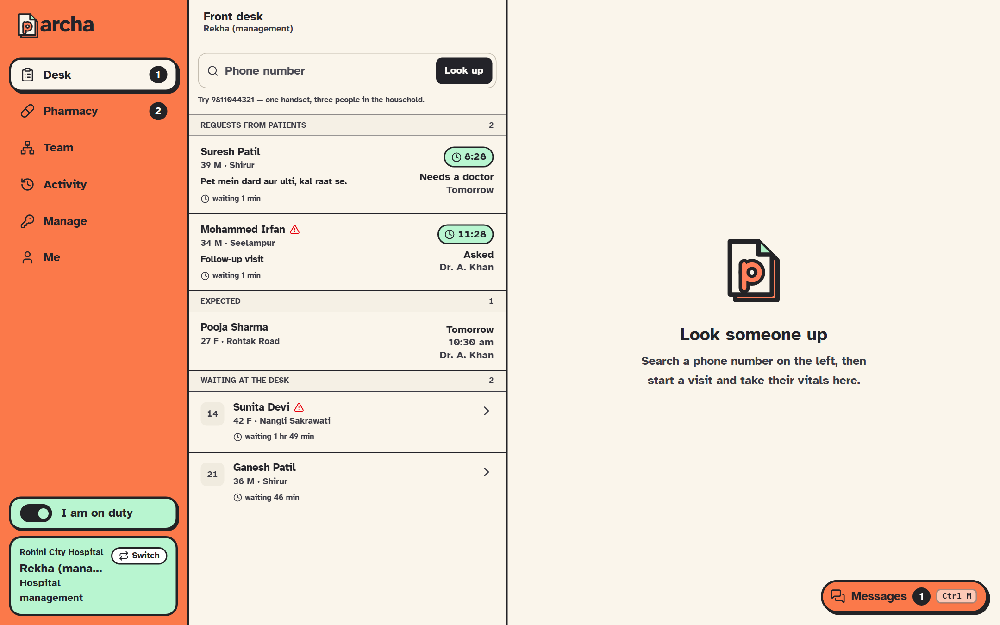
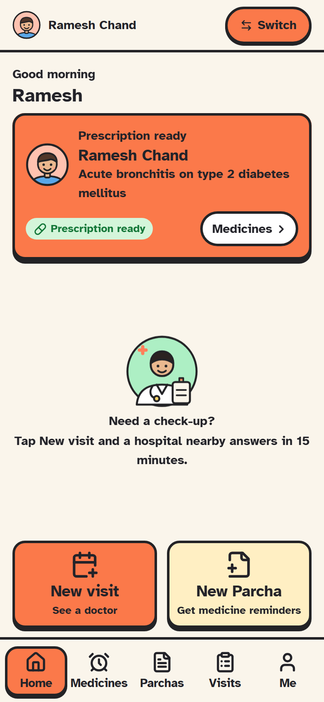
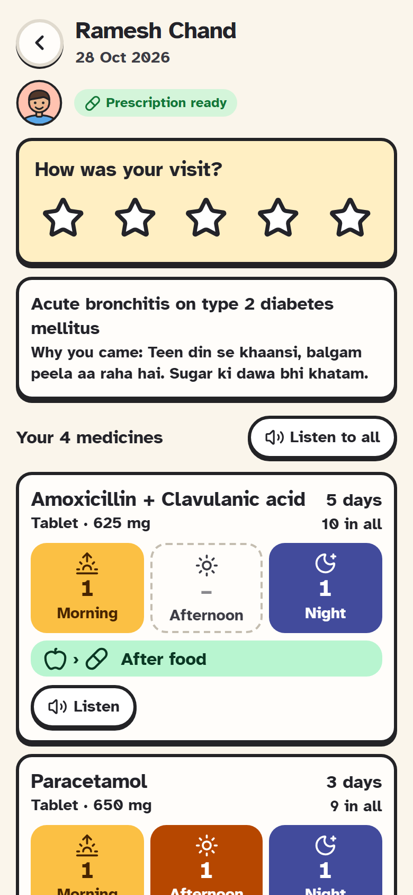
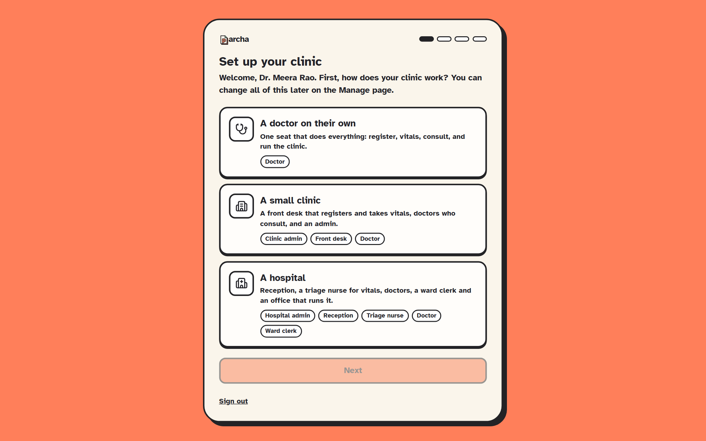
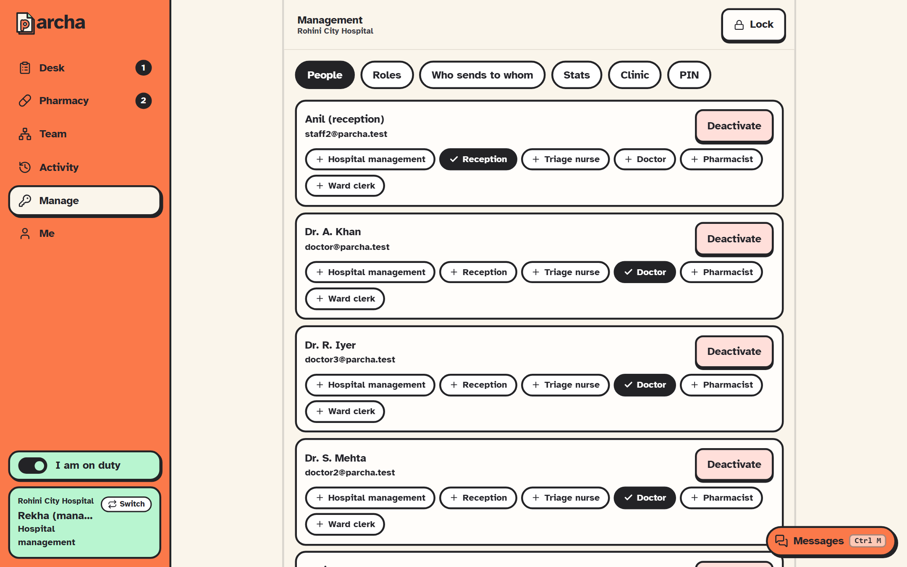
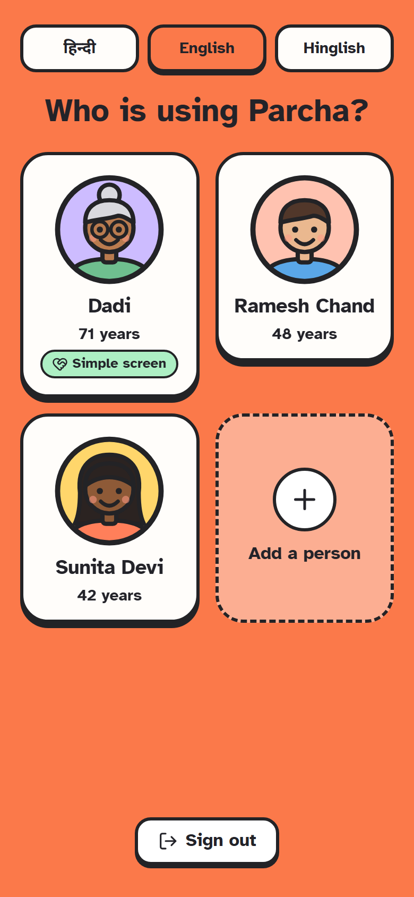
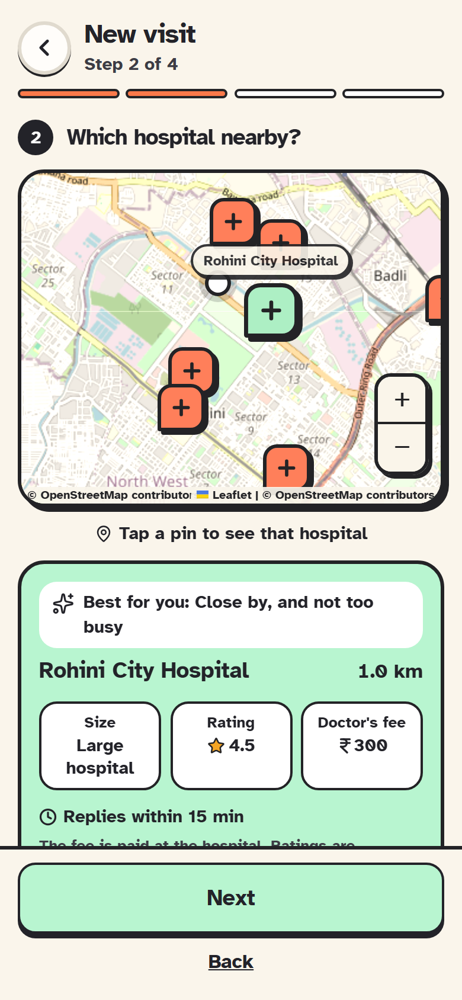
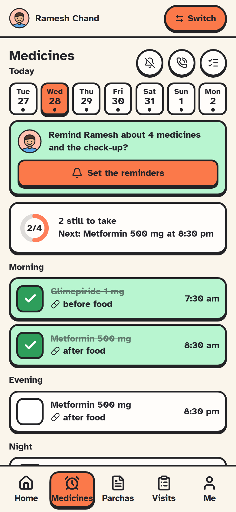
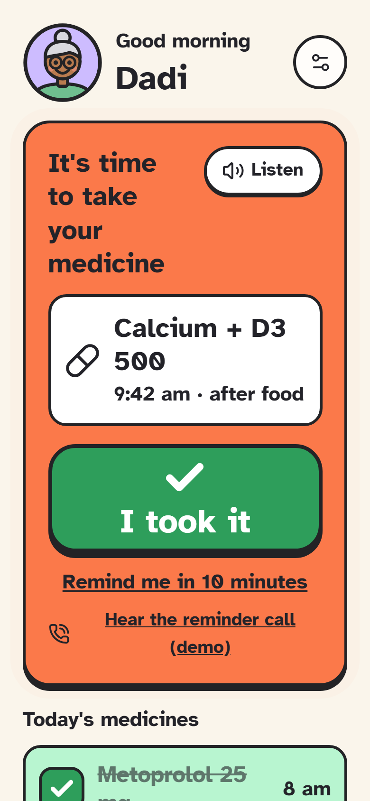

# Parcha

**A prescription in 30 seconds that the patient's family can read, hear and
follow, even offline.**

A doctor in an Indian OPD has two or three minutes a patient. Parcha gets the
prescription written in seconds (same as last visit, the doctor's own sets and
usual medicines, a search that understands "PCM 650"), checks it for allergies,
interactions and today's vitals before it is signed, and puts it on the
family's phone as pictures, in Hindi, English or Hinglish, read aloud, with
reminders and a call.
It keeps working with no internet.

Outpatient care does not usually fail at the consultation. It fails at the
handoffs: the patient waits without knowing, the desk copies the same facts, the
doctor types, and the patient forgets the medicine. Parcha cuts that chain to
what a small clinic in India actually needs.

<p align="center">
  
  
  
</p>

```
patient asks  →  desk finds a doctor  →  doctor accepts a time  →  patient arrives
   (phone)          (15-minute promise)                                 (checked in)
                                                  ↓
            desk takes vitals  →  doctor consults, safety check, signs  →  printed prescription
                                                  ↓
                  the family scans the QR on the slip  →  the patient's phone:
                  medicines by time of day, ticked off, reminders in the app,
                  on the phone, and by a phone call
```

Pharmacy and billing are optional seats after the doctor; the visit itself ends at the signed prescription. Afterwards the patient is asked how it went.

**The phone and the clinic stay apart.** Nothing clinical is pushed to the patient's
app. The phone follows the visit — the queue, the token, that the doctor has
signed — and that is all it is allowed to read; the clinic's record of what was
measured, found, prescribed and dispensed is read at the clinic
([firestore.rules](firestore.rules)). The prescription crosses the gap the way
the paper does: the family is handed the printed Parcha and scans the signed QR
on it, which carries the whole document. So what the chemist reads and what the
phone reminds about are the same slip, and a clinic's records are not sitting on
a handset nobody at the clinic controls.

## Try it

| | |
| --- | --- |
| **Patient app (web)** | https://parcha.web.app |
| **Android app** | https://parcha-android.web.app (scan the QR) |
| **Clinic program for Windows** | https://parcha-desktop.web.app |
| **Clinic app (web)** | https://parcha-clinic.web.app |

The clinic app opens on a choice of three demo set-ups around Shaheed Sukhdev
College, Rohini: **Rohini City Hospital** (a large hospital: reception, triage,
doctors, pharmacy, billing, management), **Sector 9 Care Hospital** (medium: front desk,
doctors, management), **Dr. Verma's Clinic** (one doctor who does everything),
or **Custom** (a new, empty clinic you set up yourself). The patient app opens
with the demo family phone (**9811044321**: Sunita, Ramesh and Kamla, "Dadi")
already filled in. The people and visits are sample data. The real hospitals
around the college are on the patients' map and can be asked for a visit, but
nobody at them sees it: their fee and rating are left blank, and the demo
set-ups' ratings are examples. Deploying is in [docs/DEPLOY.md](docs/DEPLOY.md).

## The apps

| | Who | What |
| --- | --- | --- |
| **Clinic app** [`apps/clinic`](apps/clinic) | Front desk, doctors, an admin | Requests inbox with a countdown; intake (vitals, complaint, choose a doctor); a doctor's queue; prescribing with typo-tolerant medicine search (or any medicine written by hand), dictation you tick through, tests to order, and a live safety check that includes children's doses and pregnancy; a printable prescription; a team page where wiring a desk to doctors is a drawing and who is on duty shows green; **Billing** from the clinic's price list, paid by cash, UPI, card or a **Razorpay** payment-page QR, with a printed receipt; **Management** for people and their roles (several per person), fees, the price list and the Razorpay page; **Messages** inside the team (Ctrl+M): end-to-end encrypted channels and direct messages, spoken messages recognised on the device, `@` a person, a token number or a patient to put a visit or an active prescription in the line (hover for a quick view, click to open it), and patients shared as links only. |
| **Patient app** [`apps/patient`](apps/patient) | Patients and their families | In **Hindi, English or Hinglish**, chosen per person; Home has the two things people come for, **New visit** and **New Parcha**; choose a hospital on a map with one suggested and why (size, rating, the doctor's fee, distance) and watch the 15-minute clock; scan the signed QR on a Parcha, or check medicines from the bill, which the phone **reads for you** (each medicine name boxed on the photo, with why, for you to add or not; nothing leaves the phone); prescriptions as pictures; say how the visit went; a day-by-day schedule with reminders and reminder calls; papers and a health summary; download or delete your data. An Android app and a PWA. |
| **Desktop program** [`apps/desktop`](apps/desktop) | The front desk | The clinic app as a Windows program: prints through the computer's printers and keeps its own encrypted copy of the data. |

## A look around

| Front desk | Doctor |
| --- | --- |
|  |  |
| Vitals and the complaint, sent to a chosen doctor. | Today's reading, allergies and history in one view. |

**The safety check** runs while the doctor prescribes, and again on the server when
they sign. A high-severity flag must be read before the prescription can be signed.


| Signed and ready to print | Who is on duty |
| --- | --- |
|  |  |

**Each clinic decides who does what.** A doctor alone, a small clinic or a hospital: set up in four steps, then people and their roles are managed behind a PIN. One person can hold several roles (a doctor who also runs the pharmacy), and what they can do adds up.

**Messages, with patients in the line.** Type `@rx` or `@` and a token number: the active prescription sits in the message as a chip, with a quick view on hover and the visit a click away. Encrypted end to end.


| Clinic set-up | Manage: seats and abilities |
| --- | --- |
|  |  |

**On the patient's phone**

| Who is using Parcha? | Home | New visit | Medicines | Easy mode |
| --- | --- | --- | --- | --- |
|  |  |  |  |  |
| A shared phone asks whose turn it is, then shows only them. | New visit and New Parcha, right there. | The map suggests one hospital and says why: size, rating, fee, distance. | The day's medicines, ticked off, with reminders. | One big screen, read aloud, for someone who needs help. |

## Features

- **The visit flow.** Request, propose, accept, check in, vitals, consult, sign. Each hospital is a wall: staff see only their own patients, team and queues.
- **The 15-minute promise.** A request a hospital does not answer in time moves to the next one by itself.
- **Prescribing that keeps up.** Fuzzy search of the medicine register ("para" finds paracetamol); dictation turned into a checklist of medicine, dose and timing for the doctor to tick (a human always in the loop); a printable prescription.
- **A deterministic safety check** for allergy, drug interaction, vitals, age, the most a day (by weight for a child) and pregnancy; a medicine not in the list can still be written by hand, marked as unchecked. No model, no guesswork: [docs/SAFETY-ENGINE.md](docs/SAFETY-ENGINE.md).
- **Reminders that reach people.** In-app, as phone notifications with Taken and Later buttons and a chime, and as **phone calls** in Hindi or English (press 1 when taken).
- **One phone, a whole family.** People with their own faces, ages and helpers; an easy mode for elders with a helper PIN; reminder calls to a person's own verified phone.
- **Hindi, English or Hinglish.** The patient app speaks one language at a time, chosen at sign-in or in Me, and each person on a shared phone keeps their own: screens, spoken medicines, reminders and notifications all follow it.
- **Messages inside the team, end-to-end encrypted.** Ctrl+M (or the button at the bottom right) opens channels for the whole hospital and direct messages only the two people can read. Every message is encrypted on the sender's computer for each reader's device; the database and the server see only ciphertext. A patient is shared as a link (record, visit or prescription), never as data: type `@` and a token number or a name, and the visit or the active prescription sits in the message as a chip, with a quick view on hover and the visit a click away. It opens only for someone allowed to see that patient. Speak a message and it is recognised on the computer itself; the sound never leaves it.
- **AI that only fills in.** The patient app reads the printed medicine names on a pharmacy bill, and checks a strip's photo shows the right medicine, on the phone itself: every name is boxed on the photo with why it counts, nothing is added until the person taps Add, nothing is suggested, and nothing is uploaded or kept: [docs/PATIENT-APP.md](docs/PATIENT-APP.md#reading-on-the-phone-ai-that-only-fills-in).
- **Works offline.** Both apps keep an encrypted copy on the device and queue changes made with no signal. The clinic can register, take vitals, consult, sign and print with the internet down: [docs/OFFLINE.md](docs/OFFLINE.md).
- **Their data is theirs.** Consent, a full export and deletion, built in.

## What is real, and what is not

Built and tested here (against the Firebase emulators):

- The visit flow, tenant isolation between hospitals, the chain to the next hospital.
- The safety check (12 tests), live and again at signing.
- Reminder calls with a demo phone line: consent, quiet hours, one retry, verified numbers.
- Offline for both apps, with the server half under test.
- **Staff sessions pinned to a place and a network**, ended the moment either changes, and an **activity log** doctors can read: who did what, from where, in plain sentences.
- **For people who cannot see or hear**: read aloud in Hindi and English, spoken reminders, larger text and high contrast; flashing, vibrating reminders and no calls for someone deaf; access needs on the patient record with a big-text "Show to patient" pad and large-print prescriptions.
- **Prescribing without voice**: search by name, brand, formula ingredient or class with same-formula alternatives; the schedule by hand (subah, dopahar, shaam, raat; every day, every few days, weekly).
- **Roles instead of fixed job titles**: each clinic decides who does what (a doctor alone, a small clinic, a hospital), with a set-up wizard, a doctor's first-sign-in profile and a PIN-protected Management page. A person can hold several roles.
- **End-to-end encrypted messages between staff** (ECDH P-256 per device, AES-256-GCM per message, HKDF-wrapped for each reader's device; private keys non-extractable in the browser), with the security rules accepting only ciphertext, keeping a direct message to its two people, and every message from the person signed in, never changed or deleted. A safety code lets two people check no key was swapped.
- **The patient app in three languages** (Hindi, English, Hinglish), per person on a shared phone.
- **93 unit tests and 58 integration tests** (rules and functions together), run on every push.

Written but **not proven**:

- The **Twilio** adapter for real calls has not been run against a live account. Indian telecom rules apply: [docs/CALLING.md](docs/CALLING.md).
- The **Android app** builds but has not been run on a device or emulator: [docs/ANDROID.md](docs/ANDROID.md).
- Capacity for "1 lakh requests" is reasoning, not a measurement: [docs/ARCHITECTURE.md](docs/ARCHITECTURE.md).
- The privacy notice is an engineering draft, not reviewed by a lawyer.
- There are no real users yet.

Not built: push for a closed phone in the browser, real phone sign-in outside the emulator.

## Run it

You need Node 22+ and Java 11+ (for the emulator). No cloud account.

```bash
npm install
npm run emulators        # auth, firestore, functions
npm run seed             # the demo hospitals, doctors and patients
npm run dev:clinic       # http://localhost:3000
npm run dev:patient      # http://localhost:3001
```

Staff sign in with the demo accounts in [docs/DEMO.md](docs/DEMO.md) (password
`parcha123`); patients pick a demo phone number. **Short on time? Follow the
five-minute path at the top of the demo guide.**

```bash
npm test                  # unit tests
npm run test:integration  # rules + functions, with the emulators running
npm run check             # typecheck both apps and build the functions
```

## How it is built

An npm workspaces monorepo:

```
apps/clinic        staff web app (Vite + React)
apps/patient       patient PWA and Android app (Vite + React + Capacitor)
apps/desktop       Electron wrapper
packages/core      pure logic: stages, safety check, schedule, call scripts
packages/client    Firebase wiring, hooks, the offline store and outbox
packages/ui        shared components and the theme
firebase/functions every write, checked on the server (Cloud Functions, asia-south1)
```

**Clients never write clinical data.** The security rules deny it, and every change is
a callable function, so the rule that "only a doctor can sign" is enforced where it
cannot be skipped. Anything clinical is append-only. Staff messages are the one
thing written straight from the app (they are not part of a record and must feel
instant); the rules hold them instead. Details in
[docs/SECURITY.md](docs/SECURITY.md) and [docs/DATA-MODEL.md](docs/DATA-MODEL.md).

## Documentation

Everything is indexed in [docs/README.md](docs/README.md).

| | |
| --- | --- |
| [Getting started](docs/GETTING-STARTED.md) | Install, run, fix the usual problems |
| [Demo guide](docs/DEMO.md) | The five-minute path, every demo account |
| [Project structure](docs/PROJECT-STRUCTURE.md) | Every folder and what lives in it |
| [Architecture](docs/ARCHITECTURE.md) | Why it should stay up, what was measured, the limits |
| [Architecture diagram](docs/architecture/parcha-architecture.html) | Every part and how a visit moves through them, each linked to its code (download and open in a browser) |
| [Data model](docs/DATA-MODEL.md) | Collections and the visit stage machine |
| [Security](docs/SECURITY.md) | Walls, roles, sessions, privacy |
| [Functions API](docs/FUNCTIONS-API.md) | Every Cloud Function and who may call it |
| [Safety check](docs/SAFETY-ENGINE.md) | The allergy, interaction, vitals, age, dose and pregnancy rules |
| [Offline](docs/OFFLINE.md) | The device store, the outbox, idempotency |
| [Clinic app](docs/CLINIC-APP.md) · [Patient app](docs/PATIENT-APP.md) | Every screen |
| [Reminder calls](docs/CALLING.md) | The calling agent and Twilio |
| [Android](docs/ANDROID.md) · [Desktop](docs/DESKTOP.md) | Building the native apps |
| [Deploying](docs/DEPLOY.md) | The live sites and how to ship |
| [Standards and law](docs/STANDARDS.md) | ABDM, ABHA and FHIR; what a valid prescription needs |
| [Testing](docs/TESTING.md) | What is tested, and how |
| [Research](docs/RESEARCH.md) | What clinics and patients complain about, mapped to the product |

## Contributing

Changes go through a pull request that passes CI (types, unit tests, builds, and
the integration tests against the emulators). Keep logic that both the apps and the
functions need in `packages/core`, with a test. A new write is a new function in
`firebase/functions`, never a client write. Screenshots in this repository are made
by `node scripts/screenshots.mjs`.

## Licence

No licence file has been added yet.
