# The clinic app

`apps/clinic`: a web app for the front desk and doctors, on a phone, tablet or
desktop (and as a Windows program: [DESKTOP.md](DESKTOP.md)). What you see depends
on the account: a doctor never sees the desk, and the desk never sees the
prescribing screen. On wide screens a list sits beside the open patient; on a
phone the same screens show one at a time with a tab bar.

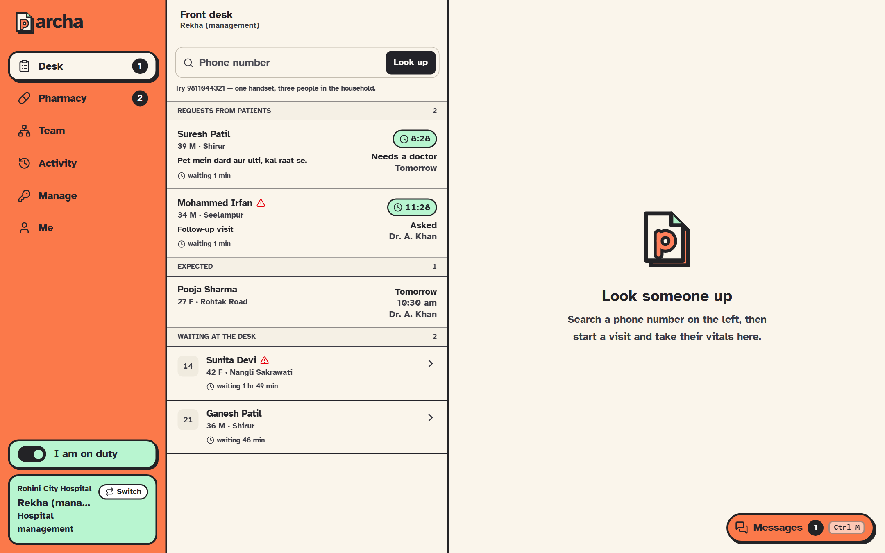

## Signing in

Email and password. The demo accounts are in [DEMO.md](DEMO.md). A device locks
after ten idle minutes and asks for the password; the password is asked for again
at the moment a prescription is signed.

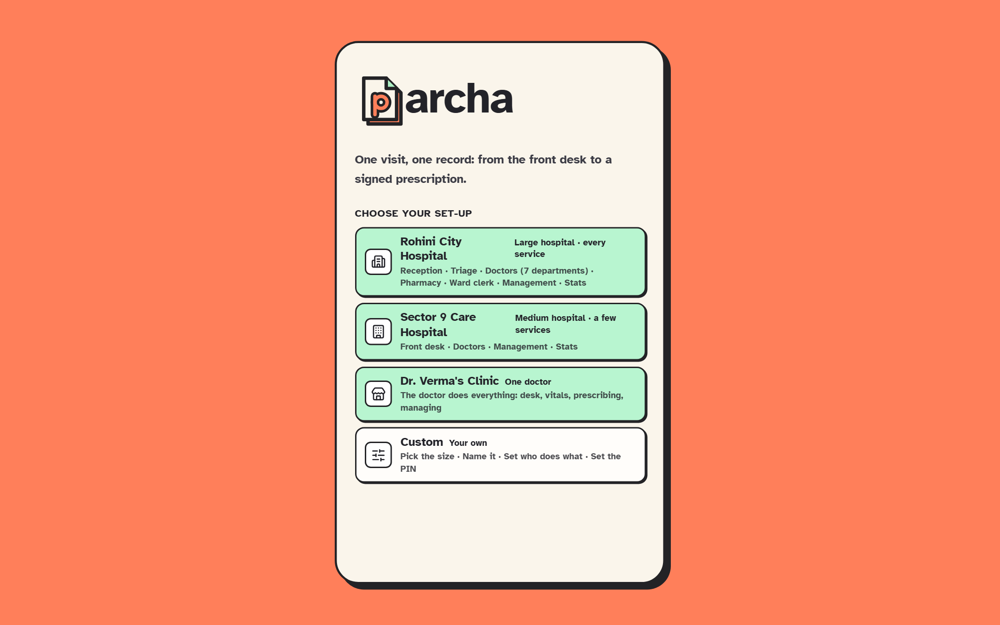

### Seats: each clinic decides who does what

There are no built-in job titles. Each clinic keeps a list of **seats**, and each seat switches on abilities: **register patients**, **take vitals**, **consult and prescribe**, **dispense medicines** (a pharmacy counter), **billing**, **read the activity log**, **manage the clinic**. The tabs a person sees follow their seat: a doctor practising alone holds everything and sees the Desk and the Queue; a triage nurse who only takes vitals sees the desk's waiting list but cannot register anyone. Anyone who can consult is a doctor patients can be sent to.

Three templates start a clinic off, and every seat can be changed later: **a doctor on their own** (one seat that does everything), **a small clinic** (admin, front desk, doctor) and **a hospital** (admin, reception, triage nurse, doctor, pharmacist, billing desk, ward clerk). A clinic that starts small adds a Pharmacy or Billing seat on the Manage page when it needs one.

**A person can hold several seats** (shown as roles), and what they can do adds up: a doctor who also runs the pharmacy holds Doctor and Pharmacist, sees the Queue and the Pharmacy, and is shown as "Doctor + Pharmacist". A role that anyone holds cannot be removed, and nobody can be left with no role.

### First run: the clinic set-up and a doctor's profile

- **Clinic set-up**, for the first person who can manage an empty clinic: choose a template, name the clinic and where it is, and set the Manage PIN. They take the template's owner seat.
- **A person's first sign-in**: their name as shown; for a doctor, the qualification and registration number (required), department and consulting hours. These are printed on every prescription they sign.

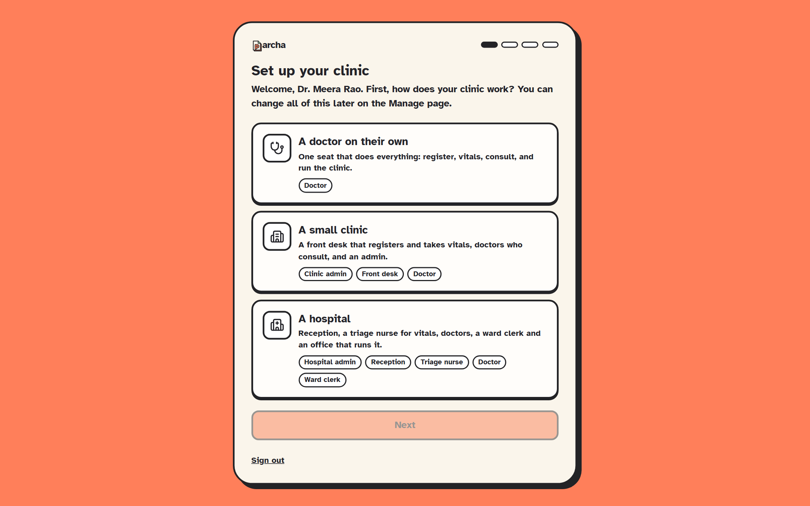

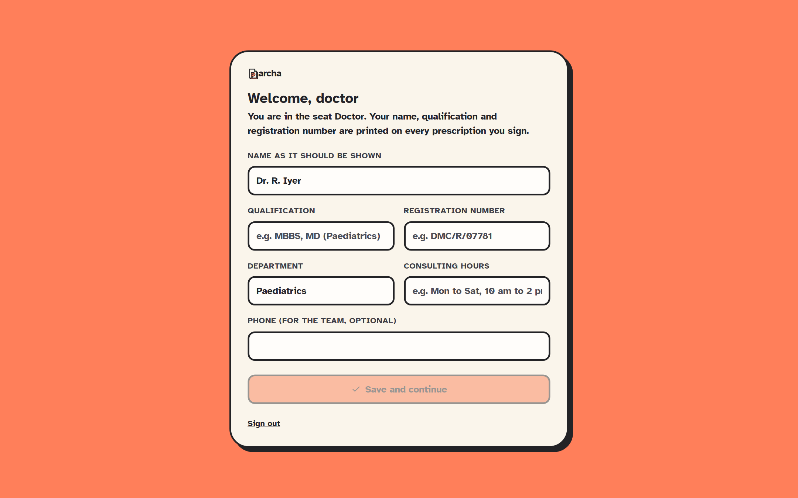

### Before it opens: location and address

After signing in, the app asks for the device's location (the desktop program asks Windows) and opens a session with the server, which records the internet address it sees. If location is blocked, the app says so and does not open. The session ends, and the device signs out with the reason, if the address changes, the device moves away, location is turned off, or the same account opens Parcha elsewhere. See [SECURITY.md](SECURITY.md#staff-sessions-pinned-to-a-place-and-a-network).

## The front desk

| Screen | What it does |
| --- | --- |
| **Desk** | One list in the order a patient moves: **requests from patients** (with the 15-minute countdown), **expected** today, and **waiting at the desk**. Search by phone number |
| **Look up** | A phone number shows everyone on that handset (a household). Start a visit for one, or register someone new |
| **Register** | Name, phone, age, sex, village. Registers the patient and starts the visit in one step |
| **Intake** | The complaint in the patient's own words; **blood pressure and weight, required every time**; under **More readings**, sugar, temperature, pulse, oxygen, breathing and height when needed; allergies on record; and which doctor to send to (only doctors wired to this desk; a doctor who is **Off** cannot be chosen, and at a real clinic neither can one who is off duty; a Busy doctor can, with a warning) |
| **Request detail** | A request from a patient: find a doctor, set what to bring, reschedule, pass it to the next hospital, or cancel |

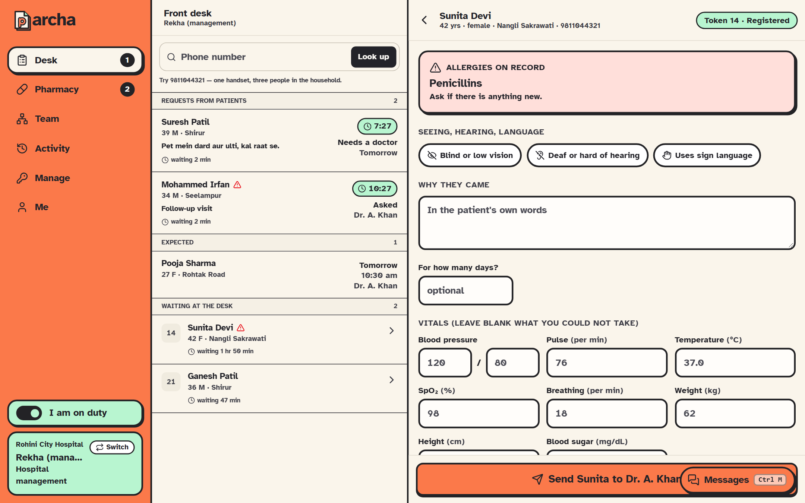

Vitals are taken here, by the front desk, before the doctor sees the patient. Blood pressure and weight are required (the server refuses an intake without them); the rest are taken when needed. Out-of-range values are flagged as the desk types them.

A **request from a patient's phone** is booked by the desk itself: choose the doctor, then a day and a time (that doctor's booked times are struck through) and **Book**; the patient is told at once and the doctor sees them in the queue on the day. **Or ask the doctor to choose the time** still sends it to the doctor instead.

Every printed Parcha carries the doctor's **stamp**, drawn by Parcha: the hospital round the top, the registration number round the bottom, the doctor's name and qualification in the middle, beside the electronic signature.

**Voice first, while prescribing.** Hold **Space** (anywhere but a text box) or press the marker at the bottom centre, and talk; let go when done. The marker grows with the voice and shows the words as they come. What was said is placed by plain rules (`packages/core/src/voice.ts`, no AI model): "diagnosis …" goes to Diagnosis, medicine names with their strength and schedule become lines, test names (CBC, dengue NS1, urine routine…) are ticked, "advice …" goes to Advice, "follow up in 5 days" sets the follow-up, "remove …" takes a line off; a whole consultation can be said in one breath. It is a conversation: after each thing said (or typed into the box under it), Parcha writes back what it did, in a sentence, and reads it aloud if the speaker is on: "Added Metformin 500 mg, twice a day, for 30 days, after food (not said: how long; check)". It keeps the thread and what was last talked about for the whole visit, so "make it 7 days", "both after food", "make it 1000", "remove that", "undo" and "read it back" work; a medicine said again changes its line instead of adding a second. It never suggests anything: it only does what was said, names anything it filled in, and says back what it did not understand. Anything a prescription needs that was not said (how often or how long a medicine, the diagnosis, a follow-up for a long-term condition) is asked, one question at a time and out loud if wanted, and the next thing said answers it; Skip leaves it. Anything not understood is said back, never guessed. Accepting a high-severity safety warning and signing stay with the doctor's hand. Everything stays on the computer: the words come from Whisper running on the computer itself (base.en, or tiny.en on a computer too slow for base: it is timed once, on first use) (`apps/clinic/src/screens/consultation/whisper.ts`): about 76 MB (tiny: 40 MB), served by the clinic app from `/asr` (fetched at build time by `apps/clinic/scripts/speech-assets.mjs`), loaded once and then cached; no audio leaves the computer and none is kept. The browser's own recogniser is never used (in Chrome and Edge it sends the sound to Google or Microsoft). The sound is recorded on the audio thread while Space is held (`public/capture-worklet.js`). Replies are read aloud only with a voice installed on the computer (Windows has Indian English ones, Heera and Ravi); an online voice is never used, and with none installed the replies are only written. Silence is not written down. Medicine names spelled by ear ("Syprophloxysin", "M load a bin") are put right by how they sound against the clinic's list (`packages/core/src/soundsLike.ts`); only names on the list are ever written.

Whenever someone is waiting on the server, a thin bar runs across the top of the app (and "Working…" if the wait goes on), so no button seems to do nothing.

## The doctor

### Built for a patient every few minutes

A doctor in a busy OPD has two or three minutes a patient, and most of what they write they have written a hundred times. The pad is built around that:

- **No Start step.** Open the patient and write. The first thing written calls them in, so the desk sees them "in the room".
- **One tap to a whole prescription.** **Same as last visit** copies the patient's last prescription (for a follow-up). **Your sets** ("Viral fever": the diagnosis, the medicines, the advice and the follow-up) fill everything in one tap; save any prescription as a set with **Save this as a set**. **Your usual medicines** are the ten this doctor writes most, one tap each.
- **Lines start right.** A medicine starts as this doctor last wrote it (strength and schedule), else as its class is usually started (a statin at night for 30 days, metformin twice a day for 30 days, a PPI before breakfast for 14 days), else twice a day for 5 days. Each line says which, and the ones that are not the doctor's own say "check it".
- **Compact lines.** Strength, days, timing and quantity in one row, OD/BD/TDS/HS/SOS one tap, and the subah/dopahar/shaam/raat schedule and the patient's picture one tap further.
- **Dictation asks only about its guesses.** What was said is shown plainly; only what it had to guess (not said, or a medicine it matched from a short form or a typo, like "ORS" or "azithromicin") needs a tick. **Add all** adds every ready line. Unsaid schedules start from the doctor's habit, not a flat default.
- **One-tap advice and follow-up.** Common advice in Hindi with English, and follow-up in 3, 5, 7, 14 or 30 days.
- **Keyboard.** Type a medicine and press Enter. **Ctrl+Enter** signs. After signing, **N** opens the next patient in your queue and **P** prints (the patient already has it on their phone).

What the pad learns (habits, usual medicines, diagnoses, sets) is kept on that computer, per doctor. It is a convenience, never the record: the signed prescription is the record, and every line is in view above the Sign button.

**Finding a medicine.** Type a generic name, a brand, an ingredient of the formula ("clav" finds Amoxicillin + Clavulanic acid) or a class ("statin"). Several words narrow it ("amox clav"), and a strength in the query ("para 650") picks that strength. The short forms on Indian prescriptions work: "PCM 650", "PPI", "CCB", "ORS", "steroid", "iron". Two medicines typed together that no single entry has ("metformin glimepiride") show each of them. Once something matches well, long-shot matches are left out rather than listed under it. Each result shows how it was found, the formula, and the other names with the same formula, so the doctor can write whatever the chemist stocks.

**The schedule, by hand.** Without dictation: tap + and − for how many at **subah, dopahar, shaam and raat**, or **Only when needed (SOS)**, and choose **how often**: every day, every 2 or 3 days, once a week, every 2 weeks, once a month. The quantity follows (a weekly capsule for 28 days is 4), the patient's reminders ring only on those days, and the slip and the patient's screen say "Once a week".

| Screen | What it does |
| --- | --- |
| **Queue** | Who is in the room and who is waiting, with their vitals and complaint at a glance. A switch says whether the desk can send you patients: Available, Busy, or Off |
| **Requests** | Patients asked for you: accept with a day and time, or decline with a reason |
| **Dossier** | Allergies, today's complaint and vitals (abnormal readings highlighted), the patient's background, and earlier visits |
| **Prescribe** | Same as last visit, your sets and your usual medicines first; then **search** (type, Enter); then **dictate** several at once. All end in the same compact, editable line. Nothing is sent until the doctor signs (Ctrl+Enter) |
| **Safety panel** | The [safety check](SAFETY-ENGINE.md) updates as medicines are added. Each high flag must be ticked as read before signing |
| **Signed** | The prescription, with dose pictures. **Next: (name)** opens the next patient (N); **Print** (P) prints it; the patient's phone already has it |

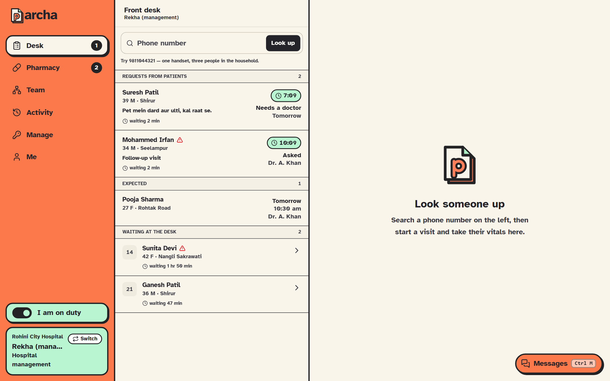

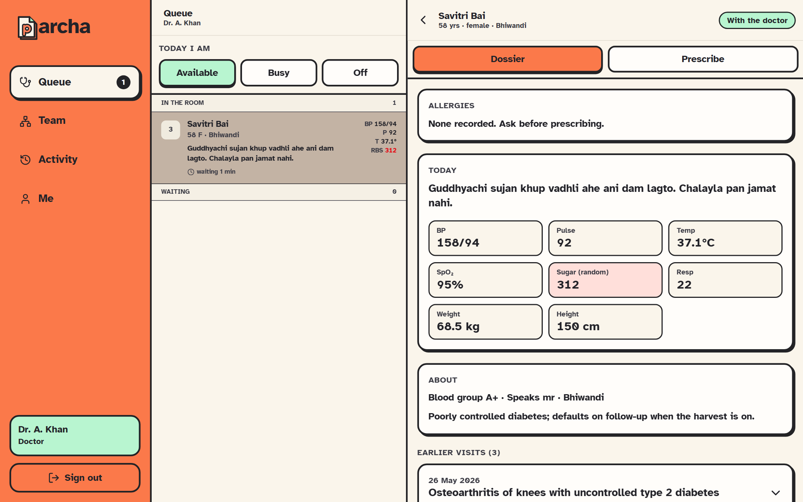

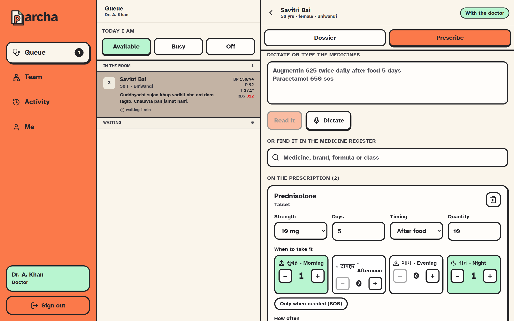

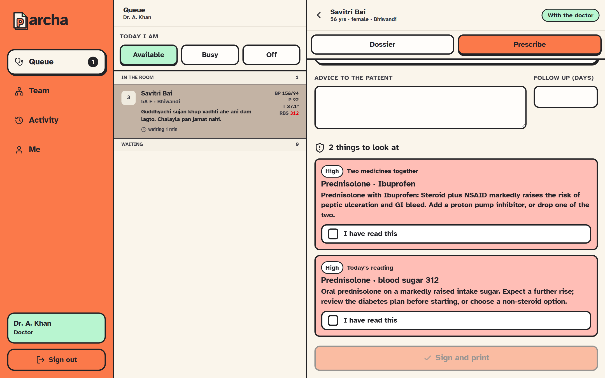

The printed prescription is the hand-off: any chemist can fill it. There is no
pharmacy or billing stage.

## Tokens, the full-page consultation, and the printed Parcha

- **Tokens:** every visit started at the desk (or a booked patient checked in) gets the day's next token (`firebase/functions/src/tokens.ts`). After intake the desk sees the token and prints a small slip with a QR (P).
- **The desk lookup** runs by itself at ten digits, and each person on the number shows their last visit.
- **The consultation is the doctor's whole screen:** no sidebar, no queue beside it; it opens on the prescribing pad with the dossier beside it, Alt+1 / Alt+2 on a narrow screen.
- **The printed Parcha** reads like a prescription to a chemist (Tab. PARACETAMOL 650 mg · 1-0-1 (BD) p.c. × 5 d) with the Hindi line for the family under each medicine (सुबह 1 · रात 1 · खाने के बाद), and a signed QR that the patient app scans.

## Team

A wiring diagram in the order a patient moves: **front desk** on the left,
**doctors** on the right. A line means "this desk sends patients to that doctor".
Admins draw a line by dragging from a desk's dot to a doctor, or tap a line to
remove it; everyone else sees the same picture read only.

Above each column: how many are on duty, and, over your own role's column, a
**duty switch** to put yourself on or off (a break does not need signing out).
A card is **green** when the person is on duty (a device open and unlocked, not
switched off, and for a doctor not set to Off) and **white** otherwise.

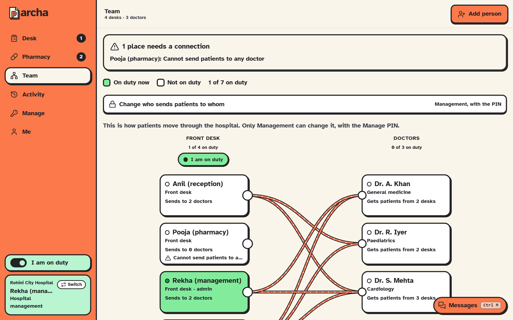

## Access needs: low vision, deaf, sign language

The desk marks them when registering a patient or on the intake (saved at once, on the patient and their open visits). The queue shows an icon beside the name, and the intake and the doctor's dossier show what to do differently, e.g. "Face them and speak clearly, or write it down; do not rely on calling their name". **Show to patient** is a big-text pad for talking with someone who cannot hear: type or tap a common sentence, and it fills the screen. **Large print** prints the prescription scaled up (it is the main button for a patient with low vision).

## Pharmacy (seats that dispense)

Today's signed prescriptions, oldest first, appearing the moment the doctor signs. Each medicine is ticked as given, with what to hand over (the count follows the schedule). If the brand is out of stock, choose another with **the same formula** from the list. Untick anything not given. **Given out** records it; the doctor reads it in the activity log in one sentence, swaps and omissions included.

## Billing (seats that bill)

Today's patients in token order, with the clinic's consultation fee filled in. The clinic's **price list** (set on the Manage page: dressing, injection, ECG and so on, each with its price) is one tap per line, and any other line can be typed. Then how it was paid:

- **Cash, UPI or Card**, taken at the desk.
- **Razorpay**: the clinic's Razorpay payment page appears as a QR, with the amount to pay. The patient scans it and pays by UPI, card or netbanking on their phone; when they show the confirmation, **Paid on Razorpay** records it, with the `pay_...` payment id from the confirmation if given (it goes on the receipt and in the activity log). A payment page does not report back to Parcha, so the desk is the one who marks it paid.

**Paid** records it and prints a receipt. **Bill now, pay later** records it unpaid; it stays on the list until paid. The header shows today's takings.

## Activity (doctors and the admin)

Who did what, newest first and grouped by day: each line is a sentence with the time, where the device was and its internet address. Filter by patients, sign-ins or team, or search for a name or a medicine. Sessions that were ended are highlighted with the reason.

## Management (behind a PIN)

Reached from the **Manage** tab, or **Management** in the sidebar's switcher (in the example set-ups this switches to the manager first). For seats that can manage the clinic, opened with the clinic's Manage PIN on top of the person's own sign-in. Five wrong PINs lock it for 15 minutes; the pass lasts 15 minutes from the last change.

- **People** (opens first): everyone on the team, each with a chip for every role; tap a chip to give or take away that role, so one person can hold several. Deactivate or bring someone back, and add a person with one or more roles (their first password is shown once).
- **Roles**: rename, switch abilities on and off (everyone holding the role changes at once), add, remove a role nobody holds.
- **Stats**: today, 7 or 30 days. Patients (walk-ins and from the app), prescriptions signed, the wait for the doctor and the whole visit, requests answered in time, when patients arrive by hour, each doctor's patients and minutes per patient, and the pharmacy's and billing desk's totals.
- **Clinic**: what patients see and can ask for: **taking requests from the app** (off: walk-ins only), **new problems** and **follow-ups** separately, how busy you are (Quiet, Busy, Full), how fast you answer a request, departments and the consultation fee. Then name, address, phone, opening hours, and the session rules: how far a device may move, and whether a new internet address ends the session or is only logged.
- **PIN**: change it (asks for your own password).

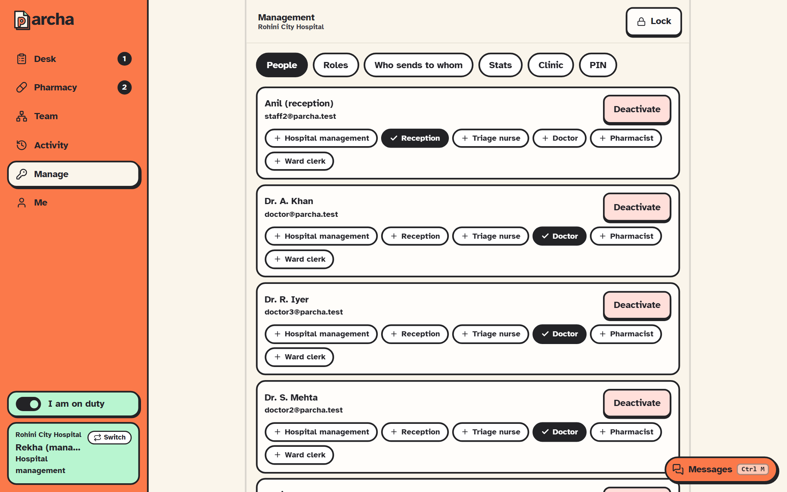

The last person who can manage the clinic cannot lose that ability or be deactivated, so a clinic cannot lock itself out. Every opening and every change is in the activity log.

## Messages (Ctrl+M)

Talking inside the team without leaving the screen. **Ctrl+M** opens it from anywhere and closes it again, as does the **Messages** button at the bottom right, which shows how many threads are unread. Esc closes it.

**End-to-end encrypted.** Each computer makes its own key the first time it opens Messages; the private half is locked inside that browser and cannot be read out, even by Parcha. Every message is encrypted on the sender's computer, separately for each device that may read it, so the database, the server and anyone running them hold only ciphertext. A direct message's **Safety code** shows the same numbers on both people's screens when nobody has slipped a key in between; compare it face to face. A computer that opens Messages for the first time cannot read what was sent before.

- **Channels** like a chat server's: **#general** is made for every hospital, and anyone can add more with **+**. Everyone at the hospital reads them. Type **@** to mention someone; they are told, and the message is highlighted for them.
- **Direct messages**: pick a person (green means on duty). Only the two of you can read it: the security rules refuse anyone else, including the rest of the hospital.
- **Speak a message**: press the microphone, talk in English or Hindi (the EN / हिं button), see the words appear, and **Stop and send**. Speech is recognised **on this computer only** (Chrome's on-device recognition; the first use may download the language). A browser that would send the sound to an outside service is refused, and typing works instead. Only the encrypted text leaves the computer.
- **Share a patient, as a link only**: the paperclip lists today's visits by name or visit code; then choose **Patient record** (age, access needs, allergies), **This visit** (where it stands, why they came, vitals) or **Prescription** (the signed medicines). The message carries only the id, inside the encryption. The reader's app looks the details up with the reader's own rights, so someone who may not see that patient sees only "A patient (not visible to you)". **Open the visit** goes to it, if their role can.
- **Files**: a file belongs in the patient's record, not in a chat; a message links to it the same way. (The clinic does not store uploaded files yet: lab reports and scans stay on the patient's phone, in their own papers.)
- A direct message or a mention that arrives while the panel is shut shows above the button for a few seconds: who, never what.

Messages are never changed or deleted, and are always from the person signed in.

## Me

Who is signed in, their counters, **Sign out**, and (on the emulator only) a
switch to pretend there is no connection for testing [offline](OFFLINE.md).

## Working offline

Registering, starting a visit, intake, consultation, signing and printing all
work with no connection and are sent in order when it returns. A strip at the
top says so; a red strip at the bottom lists anything the server refused.
See [OFFLINE.md](OFFLINE.md).
