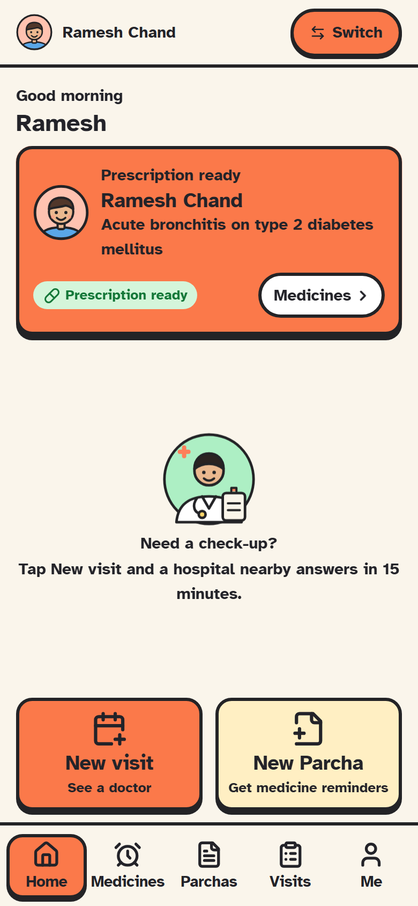
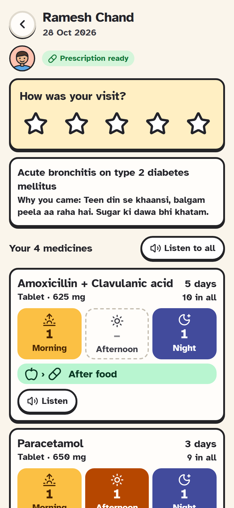
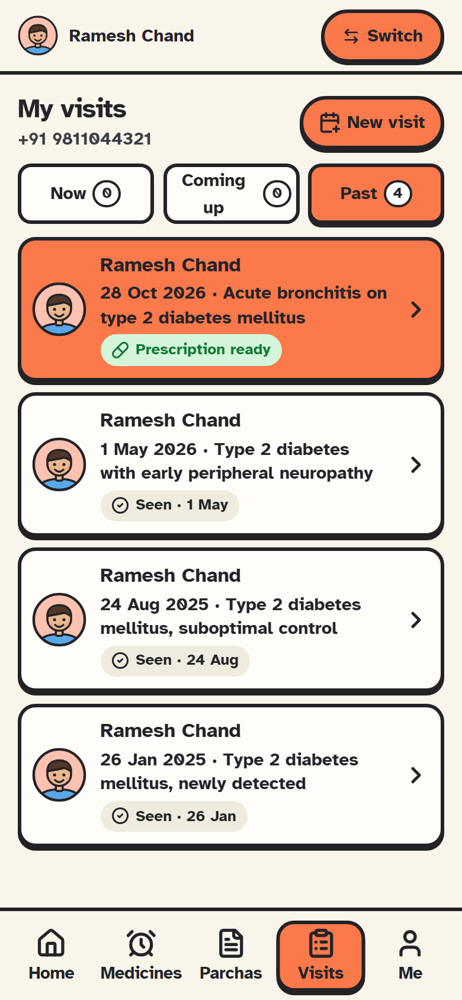
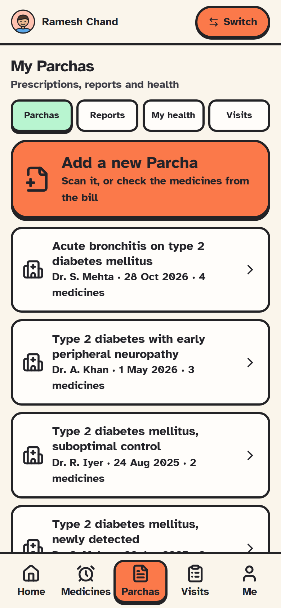
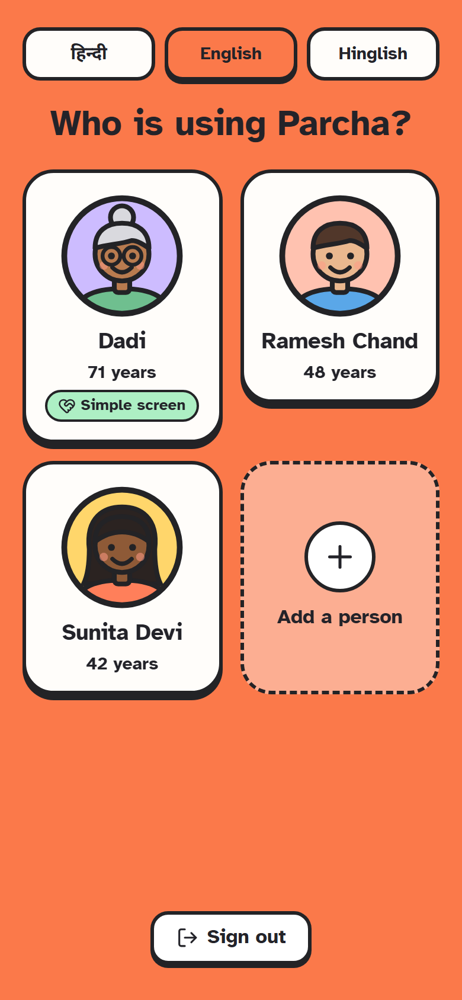
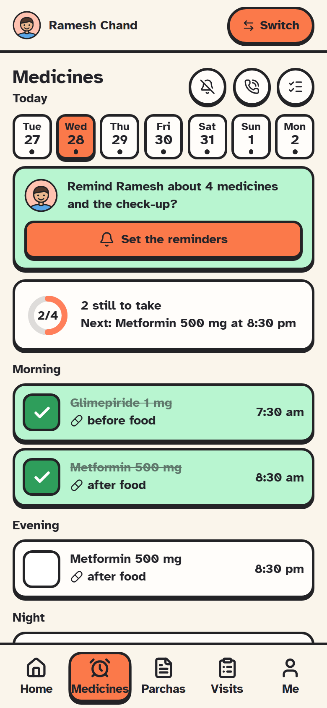
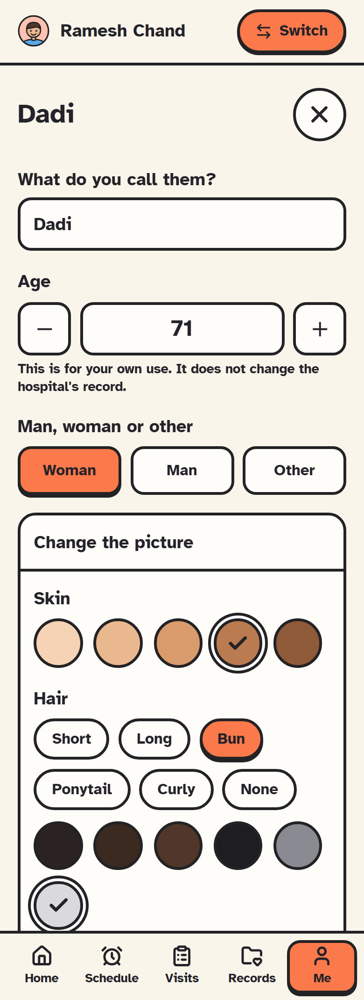
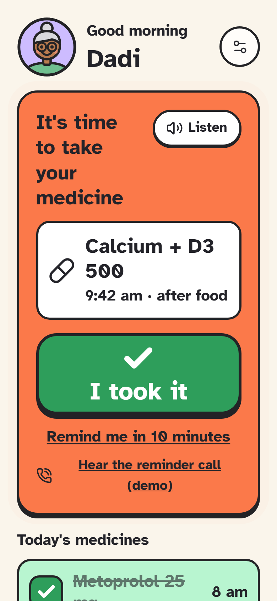

# The patient app

`apps/patient`: a mobile-first app for patients and their families. It is a PWA
in the browser and an Android app through Capacitor ([ANDROID.md](ANDROID.md)).
It is built for low-literacy, often older, users on cheap phones: big targets,
pictures before words, and one language at a time.

## The first question: "Do you have a printed Parcha?"

Each time the app is opened (not on the simple screen, which opens on the medicine that is due) it asks first:

- **Yes:** scan the square code on the printed Parcha (the phone's own camera app works too: the code is a link). The code holds the whole prescription, signed by the hospital's server; the app checks the signature on the phone with no network and refuses a code that was not made by Parcha or was changed. Then: who it is for, a photo of each strip (front and back), and a reminder for every medicine. The slip itself is kept in the phone's encrypted store. (`apps/patient/src/screens/ScanParcha.tsx`, `packages/client/src/rx.ts`)
- **No:** check the medicines another way, from RapidRX. The medicines on the pharmacy bill (added by name or brand) are lined up against what the doctor or chemist said (typed or spoken with the keyboard's microphone). Each comes out **green** (they agree), **yellow** (needs a look) or **red** (different times: the person chooses); nothing goes on until every yellow and red is settled. Photos of the prescription and the bill stay on the phone. **Read the bill on this phone** finds the printed medicine names (see *Reading on the phone* below); the handwritten prescription is never read. (`apps/patient/src/screens/CheckMedicines.tsx`, `packages/core/src/crossCheck.ts`)

At medicine time the simple screen says "दवाई लेने का टाइम हो गया" aloud, shows the strip photos, and has a demo of the reminder call (real calls need the calling agent, which is not live).

## Asking for a visit, around Shaheed Sukhdev College

One question per screen: who, what is wrong (or which doctor to see again, which also picks the hospital), which hospital nearby, which day, then a last look before asking. It is a request, not a booking. For the demo the patient is at Shaheed Sukhdev College of Business Studies, Sector 16, Rohini (`DEMO_PLACE`), not wherever the phone is. The three demo hospitals sit around it; the real hospitals nearby (Jackson, Ambedkar, Saroj, Jaipur Golden, Max and Fortis Shalimar Bagh and others, at their OpenStreetMap positions) are on the map as not on Parcha yet, with directions, and cannot be asked.

## Language: Hindi, English or Hinglish

Chosen with three big buttons on the sign-in screen, the privacy screen, the
"who is using Parcha" screen and in **Me**. On a shared phone each person keeps
their own: Dadi can read Hindi while her grandson uses English, and the app
switches when the person does. Everything follows it: every screen and the simple
screen, times ("सुबह 8 बजे", "subah 8 baje", "8 am"), the **Listen** buttons,
reminders and phone notifications. Hindi text uses Noto Sans Devanagari so bold
reads as bold. The choice is kept on the phone (`parcha.lang`, and
`parcha.lang.people` per person); consent records which language it was given in.

Sign in with a phone number and a one-time code. The demo handsets are in
[DEMO.md](DEMO.md); in the emulator the code is read from the Auth emulator for
you.

## The five tabs

| Tab | What it is for |
| --- | --- |
| **Home** | Only what needs attention: a prescription that is ready, open visits, and two big buttons: **Book a visit** and **My visits** |
| **Schedule** | A day-by-day list of medicines and check-ups, ticked off as taken, with reminders |
| **Visits** | Every visit, by person, with its status and the printed prescription as pictures |
| **Parchas** | Every Parcha (from a Parcha hospital, scanned, or checked from a bill) and **Lab reports** (and scans, insurance), kept on the phone. The health summary is under **Me**, and visits have their own tab |
| **Me** | The people on this phone, adding a visit with a code, My data, Privacy, Sign out |

## A prescription as pictures

Each medicine shows morning, afternoon and night as coloured tiles with the
number of tablets, in Hindi and English, with before or after food. The printed
copy is one tap away ("Print or save as PDF").

## Schedule and reminders

- Pick a day; filter by person; tap a medicine to tick it off.
- **Set the reminders** turns a prescription into reminders in one tap; **Add a reminder** makes one by hand (medicine, check-up, or other).
- **Alerts:** a notification with **Taken** and **Later** buttons and a chime. On Android it is a heads-up notification with its own sound, and follow-up nudges if it is ignored; in the browser it goes through the service worker (a normal browser is needed; an embedded preview has none). Later rings again after ten minutes.
- **Calls:** the phone icon switches on **reminder calls** in Hindi or English: press 1 for taken, 2 for later. A person can have their own number for calls, proved by a code read out to it. See [CALLING.md](CALLING.md).

## Visits and booking

**Book a visit** shows hospitals on a map with their load and whether they take
requests. Asking starts a 15-minute promise: if the hospital does not answer in
time, the request moves to the next one by itself. The visit shows what to bring,
with a checklist the desk sees.

## Records

Two tabs per person: **Parchas** and **Lab reports** (lab reports, scans and insurance, kept on the phone and added to the patient's own record). **My health** (conditions, allergies, current medicines, blood group and notes) is under **Me**; visits are on the **Visits** tab.

## Seeing and hearing

Each person on the phone can have their own settings (Me, then the person, then **Seeing and hearing**):

- **Cannot see well**: every medicine has a **Listen** button (English and Hindi) that reads it the way a person would say it ("Paracetamol 650 mg: one tablet in the morning and one tablet at night, after food, for three days"); reminders are spoken aloud by name when they are due; the text is larger. Uses the phone's own text-to-speech, which works with no connection.
- **Cannot hear**: reminders flash the whole screen and vibrate in long pulses instead of relying on a chime, and **no reminder calls** are made for them (the calls screen says so).
- **Larger text** and **High contrast** (black on white), on their own.

Everything is labelled for screen readers (TalkBack): the dose tiles read as "Morning: 1. Afternoon: none. Night: 1."

## Who is using Parcha?

When the app opens on a phone with more than one person, it asks **who is using Parcha**, with big faces and names (and the question in Hindi). The app then shows only that person: their schedule, visits, papers and prescriptions. A **Switch** bar at the top of every tab shows whose turn it is; tapping it asks again, and that screen also has **Add a person** and **Sign out**. Someone who needs help goes straight to their simple screen. With one person on the phone, nothing is asked.

## One phone, a whole family

A phone is often shared, and an older person may not be able to use it, so
everyone on it is a **person**.

- **People** have a face you design (skin, hair, covering, glasses, beard, bindi, colours), an age, a nickname, and who helps them. People a hospital has seen appear on their own; others are added by hand.
- **Whose turn:** tap the faces at the top of Home to say who is using the phone; the schedule, visits and papers narrow to that person.
- **Easy mode:** mark someone as needing help and their screen becomes one big page: an enormous **I took it** button when it is time (Hindi and English), today's medicines, and a **Call my helper** button. Leaving it needs the helper's PIN, kept on the phone.

## Your data

**Me, then My data** shows what is held on the phone and lets you clear it,
download a copy of everything held about you, or delete what you added.
**Privacy** shows what you agreed to. See [SECURITY.md](SECURITY.md).

## Offline

The app opens with no signal, from an encrypted copy on the phone. Ticking a dose
or adding a reminder is saved and sent in order when the connection returns; a
banner says so. See [OFFLINE.md](OFFLINE.md).

## Reading on the phone (AI that only fills in)

Two places read printed words off a photo, so nobody has to type them:

- **The pharmacy bill** ("No Parcha? Check from the bill"): the medicine names printed on it are found and each is boxed on the photo, with a zoomed cut-out of the word and why it counts ("DOLO" is Dolo 650, a brand of Paracetamol). The person taps **Add** or **Not this** for each; anything not found is added by searching.
- **A medicine strip**: after the front is photographed, the app says whether the medicine's name is printed on it ("The strip says Paracetamol"), or that it is not, so a wrong strip is caught before it becomes the picture at dose time.

The rules it keeps:

- **It only fills in.** It never suggests a medicine, a dose, a doctor or a diagnosis, and never adds anything by itself.
- **It shows its working.** Every name has a box on the photo and a sentence saying why. A name spelt exactly and read clearly is marked *Read clearly*; one a letter or two off, or read unclearly, is marked *Check*. A three-letter name (PAN, ORS) counts only spelt exactly with a strength or its form on the same line.
- **It keeps nothing and sends nothing.** Tesseract (open source, WebAssembly) runs in a worker on the phone, from files the app serves itself (`public/ocr`, copied from `node_modules` by `vite.config.ts`); the photo is never uploaded and the reader keeps no copy. Its files are fetched the first time it is used, then work offline.

What the words mean is decided by plain rules in `packages/core/src/reading.ts`, unit-tested in `packages/core/test/reading.test.ts`; the reading itself is `apps/patient/src/components/readText.ts`. Handwriting is not read: it cannot be read reliably enough to trust.

