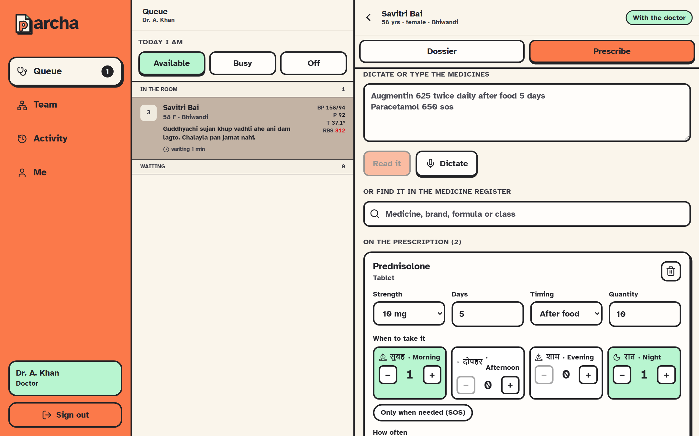

# The safety check

A deterministic check on every prescription: **no model, no API call**. The same
inputs give the same answer every time, and every flag says what it read. The
code is `packages/core/src/conflicts.ts` (20 unit tests in
`packages/core/test/conflicts.test.ts`). What it knows about children, doses and
pregnancy is in `packages/core/src/special.ts`.

## The rules

| Rule | Reads | Raises |
| --- | --- | --- |
| **Drug and allergy** | The drug's allergy classes against the patient's live allergies (retractions already removed); an allergy written as free text that names the drug | An allergy flag |
| **Drug and drug** | Every pair within the prescription, and each drug against what the patient has taken in the last month on other visits | An interaction flag |
| **Drug and vitals** | This visit's intake reading against cautions that are drug-specific or class-wide | A reading flag; the highest severity that fires is the one reported |
| **Age** | The patient's age against the youngest the medicine is given to (aspirin under 16, codeine and tramadol under 12, doxycycline under 8, fluoroquinolones under 18) | An age flag |
| **Dose** | Milligrams a day from the strength and the schedule (one tablet, or one 5 ml spoon of syrup, per dose) against the most a day; for a child under 12, against the most per kg, from today's weight | A dose flag. A child with no weight today gets a caution that the dose was **not** checked, never a silent pass |
| **Pregnancy** | Pregnant or breastfeeding, as the doctor marks it on the pad, against the medicine's note (ACE inhibitors and ARBs, statins, warfarin, NSAIDs from 20 weeks, codeine while breastfeeding, and more) | A pregnancy flag. A woman aged 12–50 who was not asked gets a note for the medicines where it matters most |
| **Written by hand** | A medicine that is not in the list, written by name | A caution that nothing could be checked for it; its name is still read against free-text allergies |

Severities are `high`, `caution` and `info`.

## Advise, then record

Flags **advise**; they do not block clinical judgement. A tool that blocks gets
switched off and the clinic goes back to paper. But a **high** flag must be
acknowledged ("I have read this") before the prescription can be signed, and the
acknowledgement is stored with the prescription. The signing function enforces
this itself, so a modified client cannot skip it: an unacknowledged high flag
makes `signPrescription` fail with `SAFETY_ACK`.

Every flag carries the `engineVersion` (`1.1.0`), so an old flag stays
interpretable as the output of the rules that were live then. Change the version
whenever a rule changes.

## Where it runs

| Where | When | Notes |
| --- | --- | --- |
| The server (`checkPrescription`) | Live, while the doctor composes | Reads the formulary (cached five minutes), the allergies, and the last month's prescriptions |
| The server (`signPrescription`) | At signing | The run that is on record; written to `visits/{id}/conflicts` |
| The computer (`packages/client/src/localSafety.ts`) | Only when the server cannot be reached | Same engine, from the formulary saved on the computer. It **cannot** see what the patient took on other visits; the screen says so. The server checks again when the action is sent |

## What it is not

A replacement for clinical judgement or a complete drug database. It knows only
the interactions, cautions, limits and notes in the formulary and `special.ts`
(textbook figures, written conservatively) and says so on screen: a clear
result means "nothing in this formulary matched", not "safe".

## Adding a rule

1. Add the data (an interaction or a vitals caution) to the seed in `firebase/functions/src/seed.ts`.
2. Change `conflicts.ts` only if a new kind of rule is needed.
3. Add a test to `packages/core/test/conflicts.test.ts`.
4. Bump `ENGINE_VERSION`.
